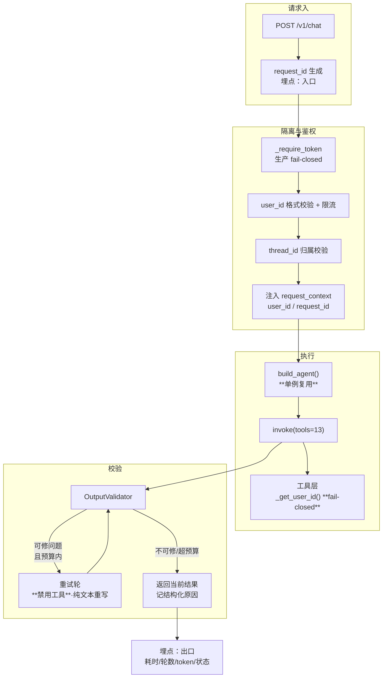

## 用户需求

对 Agent 服务做三件事：**性能优化**（消除 25.5 秒延迟的全部阻塞项）、**全面日志记录**（覆盖关键操作与异常）、**严格用户隔离与安全措施**。

## 性能优化（核心）

当前单次对话端到端 **25.5 秒**，需显著缩短。已定位的阻塞项：

1. **每请求重建 Agent 与 LLM 客户端**：每次对话都重新读配置文件、重新创建模型客户端（连接池无法复用）
2. **推理模式默认开启**：模型每次调用都走深度推理，单次多耗数秒
3. **输出校验最多重跑 3 轮完整 Agent**：实测已被触发（"重复调用 save_memory"），3 次完整调用 ≈ 25.5 秒，**这是首要阻塞项**
4. **重复工具调用判定过宽**：工具返回结果不满足预期时 LLM 的合理重试被误判为违规，直接触发全部重跑
5. **重试副作用**：重跑会重复执行写库工具，属有副作用的重复操作
6. **响应参数偏宽**：输出上限偏大、超时过长，失败时长时间挂起

## 日志记录

当前仅有 5 条启动/收尾日志，**关键链路几乎无观测**。需补齐：

- 请求级：请求 ID、user_id、会话、端到端耗时
- LLM 调用：单次耗时、token 用量、重试次数
- 工具调用：调用名、耗时、结果状态（**不记录记忆内容等隐私数据**）
- 校验过程：每轮判定结果与失败原因（结构化）
- 异常：完整堆栈、错误分类、是否可重试
- 审计：鉴权失败、跨用户访问尝试、限流触发

## 用户隔离与安全

1. **隔离缺陷（严重）**：工具层取 user_id 时，缺失则回落到共享的固定值，导致**所有用户共用一个身份、可互相搜到对方记忆**
2. **鉴权 fail-open**：共享密钥未配置时仅告警放行
3. **会话归属**：thread_id 缺省等于 user_id，需防止跨用户复用会话
4. **输入约束**：user_id / thread_id 缺少格式与长度校验
5. **限流**：无按用户维度的频率保护
6. **外部内容抓取**：需确认重定向与 DNS 重绑定防护到位

## 技术栈（沿用现有）

- Python 3.13 · FastAPI（**同步 def 端点**，跑在 threadpool）· LangChain `create_agent` + `checkpointer`
- 百炼 OpenAI 兼容端点（`ChatOpenAI`），模型 `qwen3.8-flash`
- 本地 PostgreSQL（`PostgresSaver` 同步 checkpointer）
- 标准 `logging`（`yishu/logging_setup.py`），级别由 `AGENT_LOG_LEVEL` 控制
- 复用：`agent/scripts/local_run.ps1`（启动即清 `DASHSCOPE_*`）、`yishu/context.py`（已有修好的 `current_user_id`）

**关键约束**：端点是同步的（`main.py:159 def chat`），因此 checkpointer 必须是同步接口（本次刚由 `AsyncPostgresSaver` 改为 `PostgresSaver`，修掉了静默降级为 MemorySaver 导致每轮失忆的问题，**不可回退**）。

## 实施策略

### 一、性能：消除阻塞项

**1. Agent 与 LLM 客户端单例化（阻塞 1）**

`agent.py:129` 每请求调 `build_agent(ctx)`，内部 `agent.py:82-84` 重读 JSON 配置、`agent.py:86` 新建 `ChatOpenAI`（新连接池，连接无法复用）。

改法：`build_chat_model()` 与 prompt 配置读取加 `lru_cache`；`build_agent()` 改为**模块级单例**（首次构建后复用）。system prompt 变更通过显式 `reset_agent_cache()` 触发重建（读配置 mtime 判定），避免热改 prompt 不生效。

预期收益：去掉每请求的配置 IO 与 TLS/连接建立开销。

**2. 推理模式分级（阻塞 2、6）**

`llm_provider.py:139` `enable_thinking` 默认 `True`（同文件 `:93` 注释自陈"关掉可降延迟"）。

改法：默认改 `False`（由 `AGENT_ENABLE_THINKING` 显式开启）；`max_tokens` 默认 4096→2048（实测回复均为短文本）；`timeout` 600→120 秒（失败快于挂起）。**保留环境变量开关**，需要深度推理的场景可显式开启——不做硬编码不可调。

**3. 输出校验重构（阻塞 3、4、5 —— 首要）**

现状：`output_validator.py:201` 最多 3 轮，**每轮整个 agent 重跑**（含 thinking + 13 工具 + 写库副作用）。

改法（三点，缺一不可）：

- **区分可修与不可修**：语言/分类/能力边界属"输出形态问题"→ 可重试；**重复工具调用不可重试**（记忆已写入，重跑只会再写一次并再次失败）。
- **重试不再执行工具**：重试轮使用**禁用工具**的模型实例（`bind_tools([])`），仅让 LLM 重写回复文本。副作用归零，且重试从"完整 agent 跑一遍"降为"一次纯文本生成"。
- **延迟预算**：新增 `latency_budget_s`（默认取 `AGENT_VALIDATOR_BUDGET_S`，建议 20s），累计超预算即停止重试并返回当前结果（**宁可返回不完美文本，也不让用户干等**）。

`max_rounds` 默认 3→2 且可由环境变量覆盖。

**4. 收窄重复工具调用判定（阻塞 4）**

`output_validator.py:122` 用 `(name, content[:50])` 作唯一键，把 LLM 的合理重试误判为违规。

改法：只在此前存在**失败**的工具结果时才是违规（重试合理）；全部成功且内容重复视为冗余，直接**从返回消息里裁掉冗余项**而非判失败。同时对 `content` 做归一化（去空白）再比较，避免格式微差被判重复。

**5. 工具数量（次要，低风险收敛）**

13 个工具（`agent.py:89-103`）增加 LLM 选择成本。本轮**不做删减**（会改变能力面，属产品决策），仅在日志中记录工具选择分布，为后续按意图裁剪提供依据。

### 二、日志：结构化 + 可观测

在 `yishu/logging_setup.py` 增补结构化能力，其余为增量埋点：

- 新增 `yishu/observability.py`：`request_context` 扩展 `request_id`，提供 `log_event(event, **fields)` 统一输出 `key=value` 结构化字段
- `main.py:158` `/v1/chat` 埋点：入口（user_id/thread_id/message 长度，**不记消息正文**）、出口（耗时/轮数/token 用量/最终状态）
- LLM 层：单次调用耗时与 token 用量（`response.usage`）
- 工具层：调用名 + 耗时 + 成功/失败（沿用现有 `logger` 装饰点）
- 校验层：每轮判定结果与失败原因代码化（如 `validator.language`），替代当前自由文本
- 异常层：`logger.exception` 保留堆栈，错误分类结构化
- 审计：`logger.warning` 记录鉴权失败、隔离拒绝、限流

隐私纪律：**不记录记忆内容、消息正文、token 值**，只记长度与标识（沿用后端既有纪律）。

### 三、安全：隔离 fail-closed

**1. 修复隔离缺陷（最高优先级）**

`memory_tools.py:26-31` 与 `url_fetch_tools.py:23-28` 在 context 缺失时回落 `os.getenv("COZE_USER_ID", "default")`。**`yishu/context.py:53-62` 已明确移除该危险兜底并写明理由**，但两个工具文件仍在用旧写法——同一仓库内自相矛盾。

一旦触发，13 处 `memory_tools` + 4 处 `url_fetch_tools` 的 `.eq("user_id", ...)` 过滤全部落到同一个 `"default"` ⇒ **跨用户串档**。

改法：两处统一改用 `current_user_id(default="")`，为空则**抛错拒绝执行**（fail-closed），错误码可区分（如 `CONTEXT_USER_MISSING`），并在 `agent.py:129` 入口即校验，避免执行到一半才失败。

**2. 鉴权 fail-closed（`main.py:112-115`）**

未配置 `AGENT_SERVICE_TOKEN` 时仅告警放行。改法：非生产环境保留告警（本地开发便利），生产环境（`APP_ENV=production`）**启动即拒绝启动**（fail-fast），而非运行期放行。

**3. 会话归属与输入校验（`main.py:55-57`）**

- `thread_id` 缺省等于 `user_id`（`:168`），需保证 thread_id **不能被用于读取他人会话**：约定 thread_id 必须是 `user_id` 派生值或由服务端签发；非派生值需校验归属
- `user_id` 增加格式白名单校验（长度 + 字符集），拒绝 `../`、空值、纯空白等
- 补 `max_length` 收紧与去除首尾空白

**4. 按用户限流**

新增轻量内存令牌桶（按 `user_id`），避免单用户打爆 LLM 配额；触发时返回 429 并记审计日志。阈值走环境变量。

**5. 外部抓取防护核验**

`yishu/fetch.py` 已声明有 SSRF 防护与体积/超时上限（`url_fetch_tools.py:33-37` 注释）。本轮**核验重定向后二次校验与 DNS 重绑定防护**，缺失则补齐（不重写已有防护）。

## 架构与数据流



## 目录结构

```
agent/
├── src/
│   ├── yishu/
│   │   ├── observability.py          # [新增] 结构化日志与 request_id。
│   │   │                            #   request_id 挂到 request_context.extra；log_event(event, **fields)
│   │   │                            #   输出 key=value；统一脱敏口径（不记正文/token 值）；
│   │   │                            #   提供 llm_usage 提取与耗时计时器 contextmanager
│   │   ├── context.py               # [修改] Context 增加 request_id 字段（extra 已可承载，此处显式化）
│   │   ├── logging_setup.py         # [修改] 结构化 formatter 接入；新增 AGENT_LOG_JSON 开关；
│   │   │                            #   审计 logger（logger_name=yishu.audit）独立 level
│   │   └── fetch.py                 # [核验] SSRF：重定向二次校验 + DNS 重绑定防护（缺失才补）
│   ├── agents/
│   │   └── agent.py                 # [修改] build_agent 单例化（lru_cache + prompt mtime 失效）；
│   │                                #   run_agent 入口校验 user_id 非空（fail-closed）；
│   │                                #   记录工具选择分布日志；重试轮传入禁工具模型
│   ├── llm_provider.py              # [修改] enable_thinking 默认 False；max_tokens 2048；
│   │                                #   timeout 120；build_chat_model 加 lru_cache（复用连接池）
│   ├── utils/
│   │   └── output_validator.py      # [修改] 校验项分级（可修/不可修）；重复判定收窄为
│   │                                #   「裁剪冗余」而非判失败；latency_budget_s 预算控制；
│   │                                #   max_rounds 默认 2；失败原因代码化；重试轮禁工具
│   ├── tools/
│   │   ├── memory_tools.py          # [修改] _get_user_id() 改 fail-closed（移除 COZE_USER_ID 兜底）
│   │   └── url_fetch_tools.py       # [修改] 同上（两文件口径必须一致）
│   ├── main.py                      # [修改] 入口/出口埋点；_require_token 生产 fail-closed；
│   │                                #   user_id/thread_id 校验与归属校验；按 user_id 限流；
│   │                                #   启动自检日志（工具数/超时/限流阈值/checkpointer 类型）
│   └── services/
│       └── rate_limit.py            # [新增] 按 user_id 的令牌桶限流（阈值走环境变量）
├── tests/
│   ├── test_output_validator_fast.py # [新增] 校验器分级/预算/裁剪行为（含不重跑工具的断言）
│   ├── test_user_isolation.py        # [修改] 补「context 缺失时必须拒绝」用例（当前 5 passed/1 存量失败）
│   └── test_perf_budget.py           # [新增] 延迟预算与 max_rounds 上限的回归断言
├── .env.example                     # [修改] 新增 AGENT_ENABLE_THINKING(默认 false 口径)、
│                                    #   AGENT_LLM_MAX_TOKENS / AGENT_LLM_TIMEOUT、
│                                    #   AGENT_VALIDATOR_BUDGET_S / AGENT_MAX_ROUNDS /
│                                    #   AGENT_RATE_LIMIT_RPM / AGENT_LOG_JSON 说明
└── scripts/local_run.ps1            # [核对] 确认仍在启动前清 DASHSCOPE_*（新增项无需改动，仅回归验证）
```

不修改（明确边界）：`client/utils/config.uts`、`deploy/download/index.html`、`docs/决策台账.md`、`docs/图标与签名证书_20260921.md`、`progress.md`（另一窗口在改）；`backend/`（本轮不涉及，agent 侧自治）。

## 关键代码结构

```python
# agent/src/utils/output_validator.py —— 校验分级（决定是否重试）
class IssueLevel(str, Enum):
    RETRYABLE = "retryable"      # 纯输出形态问题：语言 / 分类 / 能力边界
    TERMINAL = "terminal"        # 副作用已发生，重试无意义且会重复写入：重复工具调用

# agent/src/yishu/observability.py —— 结构化事件
def log_event(event: str, **fields: Any) -> None:
    """统一输出 `event key=value` 单行；敏感字段（正文/token/密钥）禁止传入。"""

@contextmanager
def timed(stage: str, **fields: Any):
    """记录 stage 耗时；异常时记录 exc_type 并抛出。"""
```

## 实施注意（防回归）

- **不可回退 checkpointer 修复**：`memory_saver.py` 的同步 `PostgresSaver` 刚修好静默降级（每轮失忆）问题，任何为「异步化提速」的改动都会重新引入该缺陷
- **不删工具、不改系统提示词**：属能力面与产品决策，本轮只观测
- **重试必须无副作用**：重试轮禁工具是硬要求，否则重复写库
- **启动入口清环境变量**：本机 shell 有陈旧 `DASHSCOPE_API_KEY`，而配置用 `load_dotenv(override=False)`（进程环境变量优先），任何新启动入口必须清 `DASHSCOPE_*`（`local_run.ps1` 已有此逻辑，沿用）
- **不记录隐私数据**：日志只记长度与标识，不记消息正文、记忆内容、token 值
- **诚实降级**：优化项若在特定条件失效（如 thinking 关闭后复杂推理质量下降），必须由日志暴露而非静默
- **验证口径**：改前用同一 prompt 记录基线（已知 25.5s / 直调 4.6~13.9s），改后同条件对比；`cd agent; python -m pytest tests -q`（当前 5 passed / 1 存量失败，该失败依赖真实 LLM 可用性，与代码无关）

## 验收纪律

1. `python -m ruff check`（新增文件先 `--fix --unsafe-fixes`；E501 长表达式抽函数优于折行）
2. `cd agent; python -m pytest tests -q`（不得新增失败）
3. `python scripts/review_agent.py` 快速门禁
4. `python scripts/review_agent.py --full`（当前基线 993 passed / 4 skipped）
5. `python scripts/lessons.py add --error ... --root-cause ... --fix ...`（否则 pre-commit 会拦）
6. 性能对比数据写入 commit message 与进度记录

## Agent Extensions

### SubAgent

- **code-explorer**
- Purpose: 批量扫描 `agent/src/` 全量日志埋点缺口与 `user_id` 取用点，确认结构化日志覆盖无遗漏、隔离修复无死角（含 `web/api_routes.py` 等旁路）
- Expected outcome: 输出带文件:行号的清单——所有工具/服务的 user_id 获取点、所有缺日志的关键分支、以及 `yishu/fetch.py` SSRF 防护的实际覆盖范围，作为实施前的精确施工单