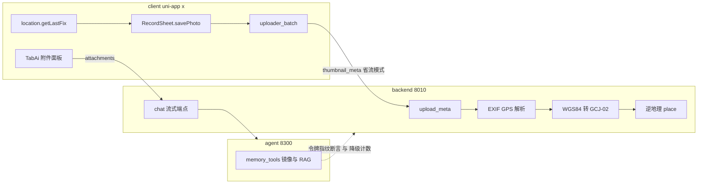

## 产品概述

针对"重构后新包体感不完整"的四类问题做根因级修复：**多模态上传接线**、**拍照定位**、**界面流畅度**、**Agent 模块三层接线缺口**。目标有二：让用户能用上"界面上已经存在"的功能；让"看起来通了其实没通"的静默失败浮出水面。

## 核心功能

**多模态上传**
- 对话附件面板可选择图片并随消息发出（当前只弹"即将上线"、6 张缩略图是静态占位）
- 蜂窝网络下照片能上传（当前恒被挂起等 WiFi）；省流上传缩略图，回到 WiFi 自动补传原件
- 拍照记录时用户选的分类不再被丢弃（当前照片路径不读所选项）
- 分享面板可复制链接、保存到相册；需要第三方 SDK 或产品未定的入口不再以"即将上线"占位

**拍照定位**
- 拍照后照片带上位置；详情页显示真实地名（当前坐标为硬编码空值，后端整条接收与逆地理链已就绪但收不到数据）

**界面流畅度**
- 语音播放时列表不再发涩、进度条不再跳动（当前每 33 毫秒重算整列表并触发重排）
- 导入几十张照片时界面不再僵住数秒（当前在主线程同步跑 O(n²) 聚类）
- 从详情页/消息页返回不再白屏（当前整页重建）
- 切到"我的"不再顿一下；隐藏标签页不再后台空转
- 语音/滚动/流式对话的观感与相位一致

**Agent 接线与诚实化**
- "AI 说已记住但 App 里没有"这类静默失败变成可见告警与计数（当前无任何报错）
- 对话页工具阶段提示完整（当前 13 个工具只映射 7 个）
- 隐私开关真实生效（当前写了本地存储但全仓无人读取）
- 清理"看起来能点其实没反应"的按钮与死代码

## 视觉与交互效果

无新页面、无新视觉风格。用户可感的变化是：按钮点了有反应或干脆不出现；照片带地点；列表滚动与播放顺滑；返回不白屏；设置项开关真的起作用。


## 技术栈

沿用现有架构，不引入新技术：

- 客户端：uni-app x（UTS + uvue，Vapor 渲染器），HBuilderX CLI 编译
- 后端：FastAPI（Python 3）+ PostgreSQL + Redis/RQ + Qdrant
- Agent：LangGraph（Python），以 HTTP 暴露 `/v1`，由后端适配器调用
- 工具链：PowerShell 5.1（`scripts/dev/*`）、Python（`scripts/review_agent.py` 等门禁与审计）、HBuilderX CLI（编译门与云打包）

## 实现方案

### 总策略

**按根因族组织，而不是逐个改症状**。四路只读审计给出 44 条带行号证据，归纳为 7 个根因族：

| 根因族 | 含义 | 影响 |
|---|---|---|
| RC-A | "定义即交付"错觉：UI 壳/API 函数/契约常量写齐即当完成，缺"点击到落库"端到端断言 | 15+ 处 |
| RC-B | 静默降级被当正常（缺令牌就 return、恒 hold、坐标 null） | 6+ 处 |
| RC-C | 本地状态写了但无人消费（假开关，含合规风险） | 3 处 |
| RC-D | 链路中段被恒假条件短路（蜂窝上传整体停摆） | 1 处、影响面最大 |
| RC-E | 重构只搬代码、没搬接线与范式 | 3 类 |
| RC-F | 平台边界未纳入设计（v-show 不停止响应式、keyframes 不支持、无 worker、裸 let 非响应式） | 5 条 |
| RC-G | 搬迁残留（死 helper、死 CSS、空函数、无监听 emit） | 5 处 |

每批"改—验—封"，并把根因**固化为门禁规则**防止复发。

### 关键决策与取舍

1. **优先复用仓内已验证范式，不发明新写法**
   - 播放态：照 `client/components/TabSearch/TabSearch.uvue:230-294` 的"预计算进卡片属性 + 相等守卫"（该文件注释已写明"原模板包装函数已删"）
   - 结构显隐：`v-if` 改 `.ui-hidden` class 切换（`client/styles/tab-index.css:781-786` 已绕过 Vapor 卸载失效）
   - 列表更新：用 `client/composables/useEventOps.uts:92-101` 的 `patchEventById` 增量补丁先例，替换"整树重建 + 整体赋值"
   - 运行期断言：照 `client/utils/config.uts` 的 `isDevCarrier()` 先例，把"靠人记的约定"变成"运行期判据"
   - 省流上传：照 `docs/待办处理排期_20260923.md:36`（A1）已写好的五步

2. **静默降级改为"显性化"而非"改 fail-closed"**：镜像与 RAG 合并缺令牌时**仍跳过，但打 WARN 日志 + 计数 + 暴露到探活端点**。理由：fail-closed 会让"agent 抖动等于全站不可用"。同时用**令牌指纹**（不泄露值）让两端可比、一眼看出不一致。

3. **附件契约做最小可用**：图片经既有上传链落库、经既有 AI 描述链产出文本，后端把附件转成 agent 可读的**文本提示**；agent 侧只加字段透传，**不新增视觉理解工具**（避免范围膨胀）。

4. **隐私开关接真消费者**：AI 请求增 `include_profile` 参数，开关关闭即不携带画像上下文。"看起来能关、实际没用"是合规风险，比"功能不全"更贵。

5. **占位入口口径**：能自闭环的**实现**（复制链接、保存到相册、缓存清理），需要第三方 SDK 或产品未定的**隐藏**（微信/朋友圈分享、手机号与微信绑定、开源许可页；隐藏是 1 行级）。

6. **坐标系必须处理**：EXIF GPS 与定位取到的是 WGS84，高德逆地理需要 GCJ-02。统一在服务端转换后再调高德，否则地名偏移数百米（比"没地点"更像 bug）。

### 性能与可靠性

- **播放态（最实锤）**：现状是 33ms 时钟写 3 个全局 ref，乘"每卡 4 到 6 次模板函数调用"，再乘全列表；其中进度条用 `width` 百分比，每 tick 触发重排。改为"写入数据时算好 + 只改活动卡"，`width` 换 `transform: scaleX`（走合成层）。涉及 4 个页面。
- **缩略图批次**：现状每 4 张回调就重建整棵日卡片树并整体赋值；且加载量只增不减，代价随使用时长单调增长。改为同帧合并 + 按内容标识增量补丁；刷新成功时重置分页计数。
- **聚类**：O(n²) 且在上传完成回调里同步执行。改为数量阈值以上才跑端侧聚类（小批量交给后端）+ 分片切片；复用现成埋点 `client/utils/agg/perf_timing.uts`。
- **上传管线是最脆弱链路**：`docs/审计_未关闭缺陷_20260923.md:86` 明定"无编译门与真机验证条件时不动上传管线"。本方案要求：改动必过编译门；**压缩失败必须退回 hold，绝不用原图冒充缩略图**；并在有真机条件时才合入。
- **平台边界即约束**：Vapor 的 `v-if` 整树卸载失效、CSS `@keyframes` 在 App 端不支持、UTS 无 worker、`script setup` 裸 `let` 非响应式、模板内函数调用插值响应性不确定。所有优化必须走已验证的替代路径。

### 执行要点（防回归）

- **编码**：含中文的 `.ps1` 保持 UTF-8 BOM（否则 PowerShell 5.1 按 ANSI 解码导致语法错误，已踩过）；`config.uts` 保持无 BOM；改 `.ps1` 用编辑器工具而不用脚本重写（会丢 BOM）
- **门禁**：改 `client/` 必过 `python scripts/client_compile_gate.py`；提交跑 `python scripts/review_agent.py`（钩子强制，禁绕过）；失败即 `python scripts/lessons.py add` 登记教训
- **提交纪律**：禁全量 add，逐路径 add；推送留给用户
- **可观测性**：本轮新增的降级与断言一律 WARN 级 + 计数，并暴露到 `/health`、`/healthz` 与 `scripts/dev/status.ps1`，让"静默"变"可见"
- **日志纪律**：热路径不加长日志（`client/composables/usePhotoAttach.uts:171` 那条长日志在缩略图热路径上，顺手降级）
- **影响面控制**：隐私开关与附件契约横跨三层，动手前先抓全量调用点；不做无关重构；跨批累积一份真机验收清单（图片通路、定位落库、流畅度观感、附件可用性）

## 架构设计

本次不新增架构层，只在既有三层之间补齐接线与观测点。修复后的两条关键数据流：



## 目录结构

```
d:\GuangH-App\
├── docs\
│   ├── 审计_接线缺口与性能根因_20261014.md        # [NEW] 44 条带行号证据 + 根因族，后续批次的对账基线
│   ├── 决策台账.md                                # [MODIFY] §7 补登新条目（画像未接 agent / 附件契约空 / 隐私开关无消费者 / settings 空开关 / 模板函数插值性能）
│   └── lessons.md                                 # [MODIFY] 登记本轮根因族教训（经 lessons.py add）
├── backend\app\
│   ├── core\config.py                             # [MODIFY] 启动期断言：agent_service_token 非空、打印令牌指纹、说明降级影响面
│   ├── main.py                                    # [MODIFY] lifespan 启动检查挂载；/healthz 增 agent 探活与镜像降级计数
│   ├── api\deps.py                                # [MODIFY] 503 fail-closed 语义保持，补结构化日志与指纹
│   ├── api\chat.py                                # [MODIFY] 接收 attachments 并转 agent 可读提示；携带 include_profile
│   ├── schemas\chat.py                            # [MODIFY] ChatAttachment 与 include_profile 字段
│   ├── api\contents\__init__.py                   # [MODIFY] EXIF GPS 解析（与既有时间解析并列）
│   ├── services\upload\upload_meta.py             # [MODIFY] meta 与 EXIF 的 GPS 合并与坐标转换入口
│   └── services\external\agent.py                 # [MODIFY] health() 接入（或由探活端点调用）
├── agent\src\
│   ├── main.py                                    # [MODIFY] ChatRequest 增 attachments；/health 暴露令牌指纹与降级计数；启动期检查
│   └── tools\memory_tools.py                      # [MODIFY] 镜像与 RAG 的静默 return 改为 WARN + 计数
├── client\
│   ├── utils\
│   │   ├── location.uts                           # [MODIFY] 精度参数；修正"照片自带 GPS"的错误注释
│   │   ├── uploader_net.uts                       # [MODIFY] resolveMode 省流返回 thumbnail
│   │   ├── uploader_batch.uts                     # [MODIFY] 压缩段接线 + thumbnail_meta 流程 + 失败退回 hold
│   │   ├── uploader_photo.uts                     # [MODIFY] buildMeta 坐标空值兜底
│   │   ├── upload_pipeline.uts / upload_protocol.uts  # [MODIFY] thumbnail_meta 模式贯通与补传原件
│   │   ├── chat_api.uts                           # [MODIFY] sendChatMessage 增 attachments 与 include_profile
│   │   ├── search_api.uts                         # [MODIFY] 图搜入口核实与接线
│   │   └── capsule_api.uts                        # [MODIFY] 胶囊列表读取
│   ├── components\
│   │   ├── RecordSheet\RecordSheet.uvue           # [MODIFY] savePhoto 填真实坐标与分类；信息卡显示地名
│   │   ├── TabAi\TabAi.uvue                       # [MODIFY] 附件面板接图片选择与附件传递；工具文案补全；流式合帧与滚动锚点
│   │   ├── TabIndex\TabIndex.uvue                 # [MODIFY] 播放态预计算；缩略图合帧与增量补丁；分页重置；列表显隐改 class；死代码清理
│   │   ├── TabSearch\TabSearch.uvue               # [MODIFY] 监听加可见性守卫
│   │   ├── TabProfile\TabProfile.uvue             # [MODIFY] 增 TTL 与脏标记
│   │   ├── ShareSheet\ShareSheet.uvue             # [MODIFY] 复制链接与保存相册实现；不可用入口隐藏
│   │   ├── PortraitPrivacyPanel\PortraitPrivacyPanel.uvue  # [MODIFY] 开关接真消费者
│   │   ├── EchoSheet\EchoSheet.uvue               # [MODIFY] 接真实图片
│   │   ├── CapsuleSheet\CapsuleSheet.uvue         # [MODIFY] 自定义日期入口隐藏
│   │   ├── UploadStatusBanner\UploadStatusBanner.uvue  # [MODIFY] 裸 let 改响应式；轮询改事件驱动
│   │   ├── VoiceWave\VoiceWave.uvue               # [MODIFY] 心跳降帧
│   │   └── TabBar\TabBar.uvue                     # [MODIFY] 返回壳改栈内回退优先
│   ├── pages\
│   │   ├── detail\detail.uvue                     # [MODIFY] 播放态预计算；返回壳改栈内回退
│   │   ├── favorites\favorites.uvue               # [MODIFY] 播放态预计算
│   │   ├── portrait\theme-detail.uvue             # [MODIFY] 播放态预计算
│   │   ├── portrait\manage.uvue                   # [MODIFY] 返回壳改栈内回退
│   │   ├── messages\messages.uvue                 # [MODIFY] 返回壳改栈内回退
│   │   ├── empty\empty.uvue                       # [MODIFY] 返回壳改栈内回退
│   │   ├── settings\settings.uvue                 # [MODIFY] 缓存清理落实；主题不支持则隐藏
│   │   ├── account\security.uvue                  # [MODIFY] 占位绑定项隐藏
│   │   └── about\about.uvue                       # [MODIFY] 开源许可占位隐藏
│   ├── composables\usePhotoAttach.uts             # [MODIFY] 索引复用，去掉热路径长日志
│   └── utils\agg\st_dbscan.uts / agg_runner.uts   # [MODIFY] 阈值降级与分片
├── scripts\
│   ├── dev\status.ps1                             # [MODIFY] 增令牌一致性与 agent 探活检查
│   ├── review_agent.py                            # [MODIFY] 新增根因类检查（写入无消费者键 / 契约常量零调用 / 模板函数插值 / 静默降级扫描）
│   └── audit_client_wiring.py                     # [NEW] 客户端接线与死代码静态扫描（供门禁复用）
├── STATE.md                                       # [MODIFY] 收尾时更新当前状态与阻塞
└── progress.md                                    # [MODIFY] 追加本轮速查卡
```

## 关键结构（接口级）

**1. 附件契约（三层）**

```
// client/utils/chat_api.uts
export interface ChatAttachment { kind: string; contentId: string; name: string; size: number }
export function sendChatMessage(conversationId: string, content: string, attachments: ChatAttachment[], includeProfile: boolean): Promise<ChatSendResult | null>

// backend/app/schemas/chat.py
class ChatAttachment(BaseModel): kind: Literal["image","file"]; content_id: str | None; name: str | None; size: int | None
class ChatSendRequest(BaseModel): content: str; conversation_id: str | None; attachments: list[ChatAttachment] = []; include_profile: bool = True

// agent/src/main.py（仅字段透传，不新增视觉工具）
class ChatRequest(BaseModel): content: str; conversation_id: str | None; attachments: list[dict] = []
```

约定：图片先经既有上传链落库并走既有 AI 描述链产文本，backend 把附件转成 agent 可读的文本提示；`include_profile=False` 时 backend 不携带画像上下文。

**2. 省流上传（照 A1 五步，失败必须退回 hold）**

```
resolveMode(auto-cellular) → "thumbnail"
  init(upload_mode="thumbnail_meta")
  前置 uni.compressImage({src, quality}) → 压缩件
  chunk + complete(压缩件, meta.upload_mode="thumbnail_meta")
  后端 register：只落 thumbnail_key 占位 + extra.original_pending=true
  记 content_id 入待补队列
WiFi 后：continuePendingUploads 凭 meta.content_id 走同一 complete 补原件
压缩失败：退回 hold（不得用原图冒充缩略图）
```

**3. 播放态预计算（模板零函数调用，只用属性）**

```
// 数据写入时算好；模板只读属性，不调函数
card.isPlaying = (activeContentId == card.contentId)
card.progressStyle = card.isPlaying ? { transform: "scaleX(" + progress + ")" } : null
// 相等守卫：仅当活动卡变化时才写，避免 33ms tick 触发全列表
```

## 验证总纲

每批以"客户端编译门 + 提交门禁 + 该批特有的可证伪验证"收口；跨批累积一份真机验收清单，由用户在装 APK 后执行：

| 批次 | 特有验证 |
|---|---|
| 静默降级显性化 | 故意留空令牌启动，两端探活应给出不一致指纹与降级计数（不报错但可见） |
| 照片定位 | 数据库查询照片记录的经纬度与地名非空；上传完成请求的 meta 含坐标 |
| 多模态上传 | 附件请求体含 attachments；蜂窝模拟下走省流模式并留待补记录 |
| 假开关 | 关闭隐私开关后请求不带画像上下文；设置项操作后状态真实变化 |
| 流畅度 | 播放时列表滚动日志与计时打点；导入批量照片时聚类耗时；返回壳耗时 |
| 收尾 | 新增门禁规则做负向探针（造样例应命中） |


## Agent Extensions

### Skill

- **uniapp-x**
  - Purpose: 校准本轮所有客户端改动的 uni-app x 正确性——模板响应性（播放态预计算与相等守卫）、结构显隐（class 切换替代 v-if）、媒体与定位 API 可用性（图片压缩、图片选择、定位精度参数）、`script setup` 裸 let 改响应式、返回导航方式
  - Expected outcome: 客户端改动一次通过编译门（无 UTS/uvue 报错），且避开 Vapor 的已知陷阱（v-if 整树卸载失效、keyframes 不支持、裸 let 非响应式）

- **harness-creator**
  - Purpose: 把本轮归纳的 7 个根因族**固化为门禁规则**（写入无消费者的存储键、契约常量零调用、模板函数调用插值、静默降级路径扫描），并保持 harness 与门禁的既有结构约定（基线只允许收缩、新增检查先做负向探针自校验）
  - Expected outcome: 新增检查在门禁中真实生效（负向探针能命中），且不产生恒红或恒绿；STATE 与台账收尾后 harness 审计维持满分

### SubAgent

- **code-explorer**
  - Purpose: ①在"静默降级显性化"批次做三层对账的交叉核验（确认断言点与降级路径全量覆盖，无遗漏）；②在收尾批次用同一份证据清单做回归抽查（防止改一处漏一处）；③对剩余盲区（后端 app 目录与 agent 源码的接线与静默失败）做专项审计
  - Expected outcome: 每批产出带文件行号证据的核验清单，且"改动前发现"与"改动后复查"使用同一份清单，可对比
