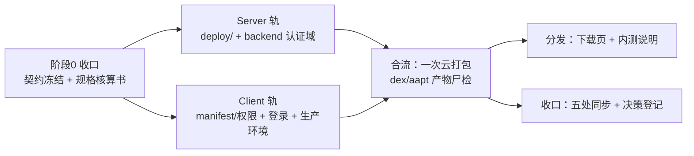
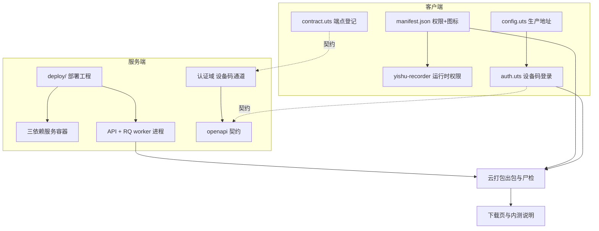

## User Requirements

- 阶段0 三项决策已确认（内测登录方案、服务器规格方向、内测期明文访问方式）；本轮需要把服务器规格**按全部负载重新核算**，给出可直接采购的结论。
- 阶段2（服务端上云）与阶段3（客户端改造）**并行推进**，产出具体的并行开发计划。
- 产出**可下发给其他 Agent 执行的任务卡**（含职责边界、前置依赖、验收口径）。

## Product Overview

面向 20 人内测的安装包下发链条：服务端能稳定运行并被公网访问；每位内测用户首次打开即自动获得独立账号与独立数据；语音记录链路在真机上可用；安装包使用自有签名、带自有图标与启动图；提供一个下载页与内测说明，用户能自行安装与反馈。

## Core Features

1. 服务器规格核算：把全部负载（常驻模型、各进程内存叠加、推理峰值、图片与音频处理、数据库与备份、磁盘与带宽）计入，给出可采购结论及「若换存储方式」的条件分支。
2. 服务端上云：依赖服务与运行时环境、模型资产预置、生产配置与密钥、后台任务进程、数据迁移与健康自检。
3. 内测登录通道：首次打开按设备自动建档、每人独立账号，用户无需输入任何邀请码，无新增界面。
4. 客户端改造：录音权限申请、真实生产地址、设备唯一标识、明文访问放行、退出登录入口。
5. 安装包与分发：自有签名证书、应用图标与启动图、打包与产物核验、下载页与内测说明。
6. 下载页视觉：单页式内测落地页，暖纸白底与品牌金点缀，含品牌区、下载区（按钮+二维码）、三步安装指引与常见问题、反馈与内测须知。

## 一、技术栈选择（沿用既有栈，不引入新框架）

| 层 | 选型 | 说明 |
| --- | --- | --- |
| 客户端 | uni-app x（Vue3 + Vapor + 自研 UTS 插件）+ TypeScript/UTS | 项目既定双轨架构，本次仅改配置与领域层 |
| 服务端 | FastAPI + RQ/Redis + PostgreSQL(pgvector) + Qdrant | 既定技术栈，本次零业务重构 |
| 部署 | Docker + Docker Compose（PG/Redis/Qdrant 三依赖服务）+ systemd 或 nohup 托管 uvicorn 与 RQ worker | 仓库当前**无 Dockerfile/docker-compose**，需新建 `deploy/` |
| 对象存储 | 腾讯云 COS（客户端 STS 直传） | key 已配齐；`STORAGE_BACKEND=cos` |
| 主机 | 腾讯云/阿里云轻量或 CVM：**8 核 16G / 系统盘 60G / 带宽 5Mbps** | 见第四节核算结论 |
| 打包 | HBuilderX CLI 云打包（单队列）+ 自有 keystore 签名 | `cli pack --platform android --iscustom true --android.packagename com.yishu.guanghua --ignoreWarnings true` |
| 下载页 | 静态 HTML 单页 | 部署于同一台服务器或 Cloud Studio |
| 密钥 | Infisical | `infisical secrets --env=dev` / `infisical run --env=dev -- <cmd>`，永不落库 |


## 二、实施策略

**核心策略：双轨并行 + 契约先行 + 文件域硬隔离。**

两条轨道天然可并行，唯一耦合点是「登录端点的形状」——客户端登录改造必须知道服务端接口长什么样。因此把该耦合点从时间轴里抽出来先冻结：



契约冻结后，Server 轨与 Client 轨互不等待，各自完成到「可被对方联调」的程度。

**关键决策与理由**

1. **登录通道复用既有 `_finish_login` 收口**，不新造登录流程：新增一个 `LoginProvider` 实现，把 `device_id` 映射为伪身份 `unionid = "device:" + device_id`。理由：`_get_or_create_user`/`_issue_tokens` 已完整覆盖建档、唯一约束并发兜底、devices 表 refresh 哈希；新通道只需实现 `resolve_identity`，改动面最小、回归面最小。`User.unionid` 为 `String unique`，长度无约束，可承载该映射。
2. **新增通道必须 fail-closed 门控**：加 `ALLOW_DEVICE_LOGIN`（默认 `false`），关闭时返回 501，语义与「微信未配置 → 501」「短信未接入 → 501」完全对齐。理由：这是内测期临时通道，若默认放开会永久保留一条「任意设备自助注册」的后门；项目既有文化是 fail-closed（`_apply_production_safety` 强制 `mock_external_ai=False`），此处必须同款。
3. **模型与进程数决定规格，而不是核数**：模型是 `lru_cache` 进程内单例、不跨进程共享；搜索为同步执行（`encode_query` 在 API 进程），因此 API 进程与 RQ worker 进程各持一份模型。规格核算的第一原则是**内测期单 uvicorn + 单 worker**，否则内存按进程数线性放大即 OOM。
4. **明文访问落工程根 `client/AndroidManifest.xml`**：该文件已被证实为云打包唯一合并点（D-19 修复已在此注册 FGS service）。`targetSdkVersion=34` 下 release 包默认禁明文，需在既有 `<application>` 节点补 `android:usesCleartextTraffic="true"`。这是内测期临时口径，上架前必须切 HTTPS 并移除。
5. **`manifest.json` 单写者**：该文件是云打包的关键输入，且同一文件内有两处权限声明块（`app.distribute.android.permissions` 与 `app-android.distribute.permissions`）。指定权限卡为该文件唯一写者，后续图标/启动图补齐串行交接，禁止两卡并发改同一文件。

**性能与可靠性要点**

- 内存：内测期强制 `uvicorn --workers 1` + 单 RQ worker。每多一个进程即多一份 BGE-M3（约 1.2G），8 核也救不回内存。
- CPU：`torch.set_num_threads(4)` 与 `OMP_NUM_THREADS=4` 已写死在代码里，**加核不提升模型吞吐**；8 核的价值只在「API 与 worker 并行不互相饿死」与缩略图/备份并行。SetFit 单条约 27s、批 10 条约 30s，为最大 CPU 热点，故分类链路必须走 RQ 异步 + 客户端轮询（现状已如此）。
- 并发：搜索并发上限 4、DB 池 5+10 为既有护栏，deploy 脚本不得擅自放大。
- 启动：`SENSEVOICE_MODEL_DIR` 必须指向预置目录，否则首个请求触发联网下载（国内网络会卡死数分钟）；BGE-M3 必须预热到 HF 缓存（约 2.2GB）。
- 备份：每日 `pg_dump -Fc` + WAL 归档（RPO ≤24h / ≤5min）；备份脚本与业务脚本分离，落独立目录。

## 三、服务器规格核算（本用户核心诉求，结论先行）

**核算结论：8 核 16G / 系统盘 60G / 带宽 5Mbps（COS 直传为前提）。**

| 负载项 | 归属 | 内存 | 依据 |
| --- | --- | --- | --- |
| OS + Docker + 日志 | 系统 | ~1.2G | 估算 |
| PostgreSQL + pgvector / Redis(AOF) / Qdrant | 容器 | 1.0–1.4G | 交付文档 §3.1（100K 向量约 128MB） |
| API 进程（BGE-M3 fp16 + FastAPI） | uvicorn | ~1.5G | `services/embedding.py:35` |
| worker 进程（SetFit + BGE-M3 + SenseVoice ONNX） | RQ worker | ~3.3G | `services/classifier.py:39-40` + `embedding.py` + funasr-onnx |
| 峰值预留（torch 激活 / PIL 缩略图 / ffmpeg 解码 / pg_dump） | — | 1.5–3G | `embedding.py:6`「默认开满核 → 16GB 机器实测 OOM」 |
| **合计** |  | **约 9–11G** |  |


- **磁盘 60G 的分账**：运行环境（torch wheel 等 pip 依赖）约 6–8G + 模型资产（BGE-M3 约 2.2G、SetFit 约 1.1–2.2G、SenseVoice ONNX 约 0.5–0.9G，reranker 3.2G 不下载）+ 镜像约 1G + PG 数据与备份余量。COS 模式下用户媒体不落盘。
- **带宽 5Mbps 成立的前提是 COS 直传**：原图经 STS 直传不经服务器，服务器只出 API JSON 与缩略图（KB 级）。
- **条件分支（若改本地盘存储）**：上传、下发、缩略图全部过服务器，20 人并发上传 3MB 照片在 5Mbps（约 625KB/s）下会排队，需升到 ≥20Mbps 且系统盘 ≥100G（或挂数据盘）。
- **必须登记的口径冲突**：交付文档《外部API清单与成本》§3.1「2 核 4G 起步、4 核 8G 更稳」的依据是「BGE-M3 568M CPU int8」，与当前实现（fp16 双模型，其中 SetFit 为 BGE-M3 底座全参微调，且两进程各一份）不符，**4 核 8G 会 OOM**。该文档为只读交付文档，**不修改**，改登记 `docs/决策台账.md` 并注明新版结论。
- **上机后实测校验项**：`free -m` 与 swap 使用、两进程实际 RSS、torch 线程数、磁盘占用分解、带宽实测（上传/下载各一次）、`/healthz` 与排队延迟。

## 四、实现要点（执行细节，防返工）

- **部署脚本一律幂等**：依赖服务用 compose 管理，业务进程用 systemd unit 或带 PID 文件的启动脚本；重复执行不得产生重复进程或重复迁移。
- **迁移走 alembic 到 head**，并在启动脚本中做「迁移后断言表存在」；CI 建库以 `schema.sql` 为源，生产增量以 alembic 为准（既有约定，不得混用）。
- **生产环境变量齐全性前置检查**：`APP_ENV=production` 会因 `JWT_SECRET`/`REFRESH_TOKEN_HMAC_KEY` 为默认值直接抛错启动失败——这是期望行为，部署手册须写明「先配密钥再启动」。同时 `MEDIA_URL_SECRET` 应为独立于 `JWT_SECRET` 的强随机值。
- **安全组只放行 22 与 8010**；5432/6379/6333 严禁对公网暴露，容器端口只绑 `127.0.0.1`。
- **前端环境切换的连带清单**：改 `ENV='prod'` 后必须同时清空 `REAL_DEVICE_HOST`、替换 `PROD_BASE_URL` 为真实地址与端口（保持 8010，避免端口漂移）；`DEV_PAGE_ENABLED` 由 `ENV` 派生会自动关闭调试页入口，无需手改。
- **设备唯一标识是最大技术不确定项**：全客户端对 `deviceId|getDeviceInfo|Settings.Secure|ANDROID_ID` **零命中**（无先例）。按项目「零先例不得凭空使用」的规则，须先查证官方支持情况再落码；不可行则退到 UTS 插件内读取系统标识（相册插件已有 `UTSAndroid.getUniActivity()`/`appContext()` 先例可复用），并把降级路径登记台账。**这是登录改造的前置阻塞项。**
- **权限申请复用既有范式而非新造**：相册插件已实现「保证回调恰好一次」的五路径权限请求类（已授予/授予/拒绝/永久拒绝/抛异常），录音权限必须复用该范式，且拒绝路径必须打点（违反即静默缺陷）。申请接线点应在录音启动函数之前，拒绝则以诚实提示终止，不得静默启动。
- **`manifest.json` 权限两处声明块都要改**，改完须以云打包产物验证（aapt 查权限清单），不能只凭本地编译通过。
- **云打包单队列**：禁止并发打包；出包后必须做产物尸检（aapt 查权限与 service、dex 扫关键类名），这是「已修」的唯一证据形式。
- **blast radius 控制**：服务端除认证域新增通道外**不改任何业务代码**；交付文档只读；不改与本次目标无关的文件；`client/` 变更后立即核对工作区是否有文件批量丢失（该环境已知会批量删 `client/` 下文件）。
- **「已修/已有」宣称必须含 git 入库存在性检查**：本项目已因「已修但从未入库」栽过三单，且当前发现三份被多文档引用的部署资产（部署就绪包、压测报告、内测包构建清单）**只存在于历史提交、不在 HEAD**，须以历史提交内容恢复后更新而非重写。

## 五、架构与目录结构



```
d:/GuangH-App/
├── deploy/                                     # [NEW] 部署工程（Server 轨独占）
│   ├── docker-compose.yml                      # [NEW] PG(pgvector:pg16) + Redis + Qdrant 三依赖服务，端口只绑 127.0.0.1，含内存上限
│   ├── Dockerfile.backend                      # [NEW] 后端镜像：python:3.11-slim + requirements + 模型资产挂载点
│   ├── .env.production.template                # [NEW] 生产全量变量模板（占位符，零真实 key），与 config.py 字段逐一对齐
│   ├── systemd/                                # [NEW] yishu-api.service / yishu-worker.service 单元文件（含重启策略与环境文件）
│   ├── scripts/
│   │   ├── bootstrap.sh                        # [NEW] 一次性初始化：目录、依赖服务、迁移到 head、表存在性断言
│   │   ├── pull_models.sh                      # [NEW] 模型预置：SenseVoice / BGE-M3 预热 / SetFit 就位校验
│   │   ├── healthcheck.sh                      # [NEW] /healthz + 依赖服务连通 + 数据库连通三连自证
│   │   ├── backup_pg.sh                        # [NEW] 每日 pg_dump -Fc + WAL 归档 + 非空校验
│   │   └── deploy_one.sh                       # [NEW] 单命令部署（对齐项目既有同名脚本习惯）
│   └── RUNBOOK.md                              # [NEW] 上机执行手册：步骤、每步验证命令、回滚、规格实测校验表、排障清单
├── backend/
│   ├── app/api/auth.py                         # [MODIFY] 新增 POST /device 端点（协议层，只做校验与转发）
│   ├── app/services/auth/providers.py          # [MODIFY] 新增 DeviceLoginProvider（resolve_identity → device 伪身份）；get_login_provider 增加 device 分支
│   ├── app/services/auth/auth.py               # [MODIFY] 新增 device_login()，复用 _finish_login
│   ├── app/schemas/auth.py                      # [MODIFY] DeviceLoginRequest（device_id/platform/app_version）
│   ├── app/core/config.py                       # [MODIFY] allow_device_login 开关（默认 False，fail-closed）
│   ├── app/core/errors.py                       # [MODIFY] 错误码登记（设备登录未开启）
│   ├── tests/test_auth_device.py               # [NEW] 门控关闭 501 / 开启建档 / 同设备幂等 / 异设备隔离 / 并发首登
│   └── docs/openapi.json                       # [MODIFY] 契约再生（只增不减）
├── client/
│   ├── manifest.json                           # [MODIFY] 权限补全（两处声明块）+ icons/splashScreens（单写者，串行交接）
│   ├── AndroidManifest.xml                     # [MODIFY] 既有 application 节点补 usesCleartextTraffic
│   ├── utils/config.uts                        # [MODIFY] ENV=prod / PROD_BASE_URL 真实地址 / REAL_DEVICE_HOST 清空
│   ├── utils/auth.uts                          # [MODIFY] 去 code:'dev-client' 硬编码、接入设备码通道、DEVICE_ID 真机唯一、登出接线
│   ├── utils/contract.uts                      # [MODIFY] 登记 PATH_AUTH_DEVICE
│   ├── utils/device_id.uts                     # [NEW] 设备唯一标识取值（含降级路径与持久化，避免每次变化）
│   ├── utils/voice.uts                         # [MODIFY] 录音前置权限申请与拒绝处理
│   ├── uni_modules/yishu-recorder/utssdk/       # [MODIFY] interface.uts 增请求接口 + app-android/index.uts 实现（复用五路径范式）
│   ├── pages/settings/settings.uvue            # [MODIFY] 补「退出登录」入口（现有封装零调用）
│   └── static/dist/                            # [NEW] 下载页产物（单页静态资源）
├── docs/
│   ├── 服务器规格核算_20260921.md               # [NEW] 核算书（含实测校验表与口径冲突说明）
│   ├── 内测下发并行任务卡_20260921.md            # [NEW] 任务卡母版（白名单/依赖/验收/铁律）
│   ├── 部署就绪包_20260828.md                   # [NEW] 从 git 历史恢复（175de68）后更新
│   ├── 内测包构建配置清单.md                    # [NEW] 构建配置与「带出门」检查项
│   └── 决策台账.md                              # [MODIFY] 规格口径、内测登录通道、明文访问、远期待办
├── AGENTS.md / progress.md / session-handoff.md / feature_list.json   # [MODIFY] 收口五处同步
```

## 六、关键接口契约（唯一需要精确冻结的结构）

```python
# backend/app/schemas/auth.py
class DeviceLoginRequest(BaseModel):
    device_id: str                      # 客户端设备唯一标识（必填）
    platform: str = "android"
    app_version: str | None = None

# POST /api/v1/auth/device  ->  ApiResponse[TokenPair]
#   响应结构与 /api/v1/auth/wechat 完全同构（客户端零分支解析，refresh 链路复用现有实现）
#   身份映射：AuthIdentity(unionid=f"device:{device_id}", device_id=device_id, platform=platform)
#   门控：settings.allow_device_login=False 时返回 501（对齐「微信未配置 501」「短信未接入 501」的 fail-closed 语义）
#   限流：沿用 auth 域既有 IP/用户双维限流中间件，不新增阈值
```

```
// client/utils/contract.uts（客户端侧契约登记）
export const PATH_AUTH_DEVICE: string = '/api/v1/auth/device'
```

## 七、用户手工清单（非 Agent 可代劳，计划中单列）

1. 购买主机（8 核 16G / 60G / 5Mbps），安全组只放行 22 与 8010。
2. 域名与实名认证；**并行提交 ICP 备案**（法定 20 工作日，不阻塞内测，今天即可提交）。
3. 生成并保管自有签名证书（keystore），记录证书 MD5（备案要用）。
4. 在 Infisical 录入/确认生产密钥条目（JWT 密钥、refresh HMAC 密钥、媒体票密钥由 Agent 生成后由用户确认注入方式）。
5. 20 位内测用户名单与反馈渠道（企微群或邮箱）。

## 八、收口门禁（不得豁免）

- 提交一律 pathspec 限定，禁 `git add -A`/reset/stash；pre-commit 快门禁不可绕；绝不 push。
- 快速门禁随提交执行，全量门禁在完成声明前与集成后执行；声明「已修」必须含 git 入库存在性检查。
- 云打包单队列，产物必须通过 aapt/dex 尸检才可声称生效。
- 全量门禁通过后收口：决策/口径登记 `docs/决策台账.md`，踩坑登记 lessons，全局数字五处同步（`AGENTS.md` / `progress.md` / `session-handoff.md` / `feature_list.json` / 交付文档需授权）。
- 密钥只经 Infisical，禁止硬编码与明文回显；交付文档只读。

## 设计定位

内测下载页（单页静态落地页）。仅在阶段5 出现，是内测用户唯一接触到的「分发界面」，按项目既有视觉基调（暖纸白 + 品牌金 + 锈红链接）设计，与 App 内页面一致，不引入新风格。

## 页面规划（1 页，4 个区块）

### 区块 1 · 品牌区

整屏上半部。左侧 App 名「忆述光华」大字 + 内测版号 + 一句话价值说明（把照片、文字、语音碎片自动整理成回忆）；右侧应用图标浮起展示、下方柔和投影。背景暖纸白叠加极淡纸纹，底部一条品牌金到锈红的细渐变线过渡到下一区块。

### 区块 2 · 下载区

主行动按钮「下载内测版 APK」为核心视觉焦点，品牌金实底、圆角、悬停上浮微动效；旁侧二维码供手机扫码直下。按钮下补一行文件大小与更新日期，并以小字注明「仅限受邀内测用户」。整块置于淡卡色卡面上与背景形成层次。

### 区块 3 · 安装指引与常见问题

三步卡片（允许安装未知来源 / 华为机型先关闭纯净模式 / 首次打开授权麦克风与相册），每步编号 + 线性图标 + 短文案，横向排列、窄屏自动纵排。下方接折叠式常见问题（安装失败、录不进声音、登录进不去），点击展开下滑，避免整页过长。

### 区块 4 · 反馈与内测须知

左侧反馈入口（群二维码或邮箱，一键复制），右侧内测须知要点（数据仅用于内测、可能丢失、请勿上传敏感内容）。页脚放备案号占位、隐私政策链接与版权信息，文字弱化处理。

## 交互与响应式

滚动渐显（配重淡入 + 轻微上移，尊重减少动效偏好）；按钮与二维码悬停微反馈；移动端单列、桌面端两列栅格（下载区左右分栏）；最大内容宽约 960px 居中，保证手机端一屏内可见主按钮。

## Agent Extensions

### Skill

- **Code**
- Purpose: 为两条轨道提供「先计划、再实现、后验证」的工作流约束，保证每个任务卡按可验证步骤推进而非一次性倾倒代码。
- Expected outcome: 各任务卡产出「改动文件清单 + 验证命令与结果 + 未闭环项」三段式交付报告，每步可独立验证。

- **executing-plans**
- Purpose: 把本轮产出的任务卡母版分发给独立会话/其他 Agent 执行，并在每个检查点做复盘与打回判断。
- Expected outcome: 每个任务卡在独立会话中被逐条执行、逐条验收，越界或未通过门禁的交付被打回重做，而非合并后才发现问题。

### SubAgent

- **code-explorer**
- Purpose: 在契约冻结与权限改造两处做跨文件核实——确认认证域现状与客户端契约文件引用关系、确认权限申请先例与可复用点，避免凭猜测落码。
- Expected outcome: 产出「符号 → 文件:行号 → 调用方」三级证据清单，明确哪些代码可直接复用、哪些属零先例需另找路径。

### Integration

- **cloudStudio**
- Purpose: 部署内测下载页（静态单页），返回可直接发给内测用户的访问地址。
- Expected outcome: 下载页上线并可公网访问，页面上的 APK 下载按钮指向真实产物地址，二维码扫码可下。