# 架构扩展：三合一陪伴智能体 V2（忆述光华适配版）

> 基线：`三合一终极智能体架构（定稿固化版）`（RP 陪伴 + 全模态资产 + 长期记忆）
> 需求基线：45 条需求（`45条需求_架构满足矩阵.md` / `需求清单_人话版_20261118.md`）
> 本次口径：**RP 保留**；45 条全部要有架构归属，不以"不做"回避；原稿与需求冲突处以本版为准
> 2026-11-20

---

## 一、结论先行

原稿解决的是"**聊得好 + 找得到**"两件事；45 条需求要求的是"**收得进、串得起、推得回、删得掉、分得开、说得像人**"六件事。所以本版不是改参数，是**补三个缺失的结构**：

1. **时间结构**：原稿的记忆是"对话事件"，需求要的是"照片/语音/文字聚合成一件事、再串成时间轴与故事线"。新增 `事件聚合域`，并把"事件"设为检索与回响的**最小单元**。
2. **主动结构**：原稿只有被动响应，需求 19-25 要"去年今日/培育成长/静默时段/雷区"。新增 `回响调度域`，把"算什么时候推、推什么、不推什么"做成可测的规则函数，而不是文案。
3. **信任结构**：原稿只有"权限开关"，需求 26-34 要"首屏讲清、可删可导出、删了真删、只分析不训练、改过的永不覆盖"。新增 `信任与生命周期域`，把承诺做成状态机与回执。

外加两个横切：**评测门禁域**（需求 17/45 要求"不达标就降级"必须可测）与**闲时调度域**（后台 AI 不常驻，只是约束，不是功能）。

保留不动的四条骨架：**分层解耦、三层记忆物理隔离、模型只有提案权、资产只读注入**。RP 不只是保留，而是**升级为产品主界面**——它是"回忆陪伴者"，不是"剧情角色"。

### 1.1 十八张图看哪里

**主图六张（回答"系统长什么样、一次请求怎么走"）**

| 图 | 回答什么问题 | 位置 |
|---|---|---|
| 01 总图 | 系统由哪些层和域组成，依赖往哪走（L6 端 → L0 基建，单向） | §3.1 |
| 02 请求链路 | 一次"陪聊中引用我自己的照片"要走九步、各步多久、五路取料怎么并行、哪里能降级 | §3.2 |
| 03 五个 Agent 分工 | 五只各守哪一段：触发档位、读什么、出什么、失败怎么办、谁没有写权 | §4.5 后 |
| 04 摄入分级 | 5000 张照片从"收到"到"可图搜"的四级产物，为什么不能用一张百分比条 | §5.1 后 |
| 05 删除生命周期 | "删了就是真删"如何证明确实四层都清了 | §5.6 后 |
| 06 检索降级链 | 为什么永远不给空结果，degraded 时为什么禁止反问 | §5.3 后 |

**补充十二张（回答"每只 Agent 内部怎么跑、每个域长什么样"）**

| 图 | 回答什么问题 | 位置 |
|---|---|---|
| 07 Linger 范式对比 | 我们照搬了哪四点、刻意改掉了哪五点、为什么改 | §4.6 |
| 13 事件四层 | L1 内容 → L2 会话 → L3 事件 → L4 故事线，以及"用户拆开永不被算法回滚" | §5.2 |
| 14 回响资格链 | eligible() 六道 AND 闸，为什么"不推"是默认而不是失败 | §5.4 |
| 15 记忆四层 | 四层各存什么、谁写谁读、优先级铁律、参考了谁 | §5.5 |
| 16 记忆读写 | 两阶段写 + 双时序（关旧行开新行）+ 读取顺序与 600 字硬预算 | §5.5 |
| 17 有人味 | 共情 / 性格 / 情绪描述 / 危机接管四件互不替代的事 | §5.7 |
| 18 家庭权限 | 角色 × 范围矩阵、三张表、老人端受限形态、四条红线 | §5.8 |
| 08 Muse | 主生成：唯一出话、唯一无写权的那只，内部五件套与三态失败 | §4.6 |
| 09 Librarian | 检索：只交证据不给结论，三条通道与两轮放宽的边界 | §4.6 |
| 10 Serendipity | 预取：只准备不发言，候选池与 TTL 的约束 | §4.6 |
| 11 Provenance | 校验：只判不写，私料无证据 fail-closed 的判据 | §4.6 |
| 12 Sculptor | 离线整理：只加层不改原文，幂等与可回滚 | §4.6 |

---

## 二、原稿逐构件评审（客观，含判负项）

| 原稿构件 | 判定 | 理由 | 本版处置 |
|---|---|---|---|
| Orchestrator 三类意图分流 | 保留 | 分流思想正确 | 扩为 5 类 + 1 混合（新增"摄入/整理""回响/推送""设置与信任"） |
| RP Harness 五 Agent（Muse/Librarian/Serendipity/Provenance/Sculptor） | 保留 | 权限隔离 + 离线整理是长线一致性的关键 | 保留全员，Provenance 改**触发式**（涉私料/敏感/纠错时才全量校验），控成本 |
| RP 状态机（好感度/情绪/剧情 Flag/关系等级） | 改造 | "好感度""剧情 Flag"是恋爱剧情语义，与回忆产品不匹配 | 改为**熟悉度/情绪基调/故事线进度/关系类型**，字段保留形状，语义替换 |
| 上下文帧模板 | 保留 + 增段 | 缺"画像投影"与"参考块隔离"两段 | 新增 `ProfileDigest` 与 `PRIVATE_REFERENCE` 独立区块（只读、带溯源） |
| 长期记忆双方案 Mem0 / Zep Graphiti | **降级为端口** | 二者优势集中在窄场景；Graphiti 无 PG 后端、Kuzu 上游已停维护；引入即新增运维面与第二真源 | 抽象 `MemoryPort`，**落地绑定 PG + Qdrant**；只借 Graphiti 的**双时序字段设计**（`valid_from/valid_to` + `recorded_at`），不引依赖 |
| 资产管线（视频/PDF/公众号） | **删除** | 本产品输入只有照片、语音、文字、微信转发；无视频/文档/公众号入口 | 删除该三条支线，接口留空位不实现；`AssetType` 枚举只保留 photo/voice/text/wechat |
| 资产权限（全局 RP 开关 + 单文件私密） | 升级 | 只有"能不能看"，没有"能不能用来训练""家人能不能看""删了怎么证明" | 拆成 `ConsentPort`（用途授权）+ `VaultPort`（保险箱）+ `FamilyScope`（家庭可见性）三套 |
| 三层记忆隔离 | 保留 + 补一层 | 缺"用户修正"这一类，而需求 33/40 要求"改过的永不覆盖" | 扩为**四层**：叙事陪伴记忆 / 用户事实记忆 / 资产索引 / **偏好与修正记忆** |
| 全局安全校验 | 扩为三层 | 原稿只有前后置过滤，没有分级处置 | 扩为 `输入护栏 → 生成约束 → 后置溯源/共情校验`，外加**危机三级 T1/T2/T3** |
| （原稿缺失）摄入编排 | 新增 | 需求 1/4/5/7/27 要"批量导入 + 分级索引 + 折叠 + 进度" | 新增 `摄入域`（Ingest），含 L0-L3 状态机与配额 |
| （原稿缺失）事件与时间轴 | 新增 | 需求 3/13/18/23 要"按一件事给、时间轴串事、成长线" | 新增 `事件聚合域`（四层聚合 + 人工可拆并） |
| （原稿缺失）回响与推送 | 新增 | 需求 19/20/21/22/25 | 新增 `回响调度域`（资格计算 + 雷区 + 静默 + 频率） |
| （原稿缺失）信任与生命周期 | 新增 | 需求 26/28/29/30/31/32/34 | 新增 `信任域`（Consent / Vault / Delete / Export / TrainingGate） |
| （原稿缺失）评测 | 新增 | 需求 17/45 要"能测、能降级" | 新增 `评测域`（评测集 + 难负例 + CI 闸门 + 降级开关） |
| （原稿缺失）分人与适老 | 新增 | 需求 41-44 | 新增 `家庭与角色域`（family 授权 + 老人端 token 档 + 问答引导） |

> 一句话：**原稿是"陪伴 + 检索"的双核，本版是"陪伴 + 摄入 + 检索 + 回响 + 信任 + 分人"的六域一核。**

---

## 三、目标架构总图

```text
╔══════════════════════════════════════════════════════════════════════════════╗
║ L6 端侧（uni-app x + UTS 原生）  一套代码，四种运行形态                        ║
║  ① 本人端（默认）   ② 子女端（代建）   ③ 老人端（适老 token 档）   ④ 妈妈端（成长线）║
║  组件：导入器 / 时间轴 / 检索框 / 回响卡 / 陪伴对话 / 信任中心 / 保险箱 / 分享   ║
╚═══════════════════════════════╪══════════════════════════════════════════════╝
                                ▼  JWT / STS 直传 / 分片上传 / 断点续传
┌─ L5 接入层 ──────────────────────────────────────────────────────────────────┐
│ API 网关：鉴权、限流、幂等键解析、参数归一、结果剪裁                            │
│ 三个入口族：用户端 REST · 服务端 Agent 端点（X-Agent-Token）· 微信回调（验签）   │
└───────────────────────────────┬──────────────────────────────────────────────┘
                                ▼
┌─ L4 编排层 Orchestrator（唯一大脑，无状态）──────────────────────────────────┐
│ 意图路由 6 类：① RP陪伴 ② 检索回忆 ③ 摄入/整理 ④ 回响/推送 ⑤ 设置与信任 ⑥ 混合 │
│ 职责：选路、并行拉起、预算控制、超时降级、把"证据块"注入上下文、写回提案       │
│ 铁律：路由只做"选谁干"，不做"替谁干"；任何分支失败都必须落到三态语义           │
└───┬───────────────────────┬───────────────────────────┬──────────────────────┘
    ▼                       ▼                           ▼
┌─ 核心 A：RP 陪伴 Harness（旁挂 Agent 进程，LangGraph）──────────────────────┐
│  Muse 主生成（必跑） · Librarian 检索（合并调用） · Serendipity 预取（异步）  │
│  Provenance 校验（触发式） · Sculptor 离线整理（夜间闲时）                    │
│  人设卡 / 状态机 / 上下文帧 / 输出闸 / checkpointer（执行态，独立 schema）   │
│  ⚠️ 不持 COS、Qdrant 凭据；不碰 crisis/12356；不直接写业务表                  │
└───────────────────────────────┬──────────────────────────────────────────────┘
                                ▼ 只经端口读 App 能力（4 个端点 + 端口协议）
┌─ 核心 B：回忆资产内核（backend B 域，纯策略在 L1，适配在 L3）───────────────┐
│  B1 摄入域      Ingest：批量导入 / 语音速记 / 微信转发 / 分级索引 / 折叠       │
│  B2 事件域      Event：四层聚合 / 时间轴 / 故事线 / 人工拆并                   │
│  B3 检索域      Retrieval：单次归一 / 三通道一致 / 三级降级 / 溯源 / 反问      │
│  B4 回响域      Echo：资格计算 / 雷区 / 静默时段 / 成长对比 / 分享与回忆册     │
│  B5 记忆域      Memory：画像投影 / 事实双时序 / 修正优先 / 遗忘                │
│  B6 信任域      Trust：用途授权 / 保险箱 / 删除生命周期 / 导出导入 / 训练闸门   │
│  B7 有人味域    Human：共情 / 性格 5 维 / 情绪契约 / 危机三级                  │
│  B8 家庭域      Family：家庭组 / 权限 / 交接 / 老人端 / 问答引导 / 术语        │
│  B9 评测域      Eval：评测集 / 难负例 / CI 闸门 / 降级开关                     │
└───────────────────────────────┬──────────────────────────────────────────────┘
                                ▼
┌─ L2 端口层（Protocol / 函数签名；失败必须三态以上）─────────────────────────┐
│ SearchPort · TimelinePort · IngestPort · EchoPort · MemoryPort · ConsentPort  │
│ VaultPort · LifecyclePort · ExportPort · PersonReadPort · ProfileDigestPort   │
│ GuardPort · CrisisPort · PersonaPort · FamilyPort · EvalPort · MemoryWritePort │
└───────────────────────────────┬──────────────────────────────────────────────┘
                                ▼
┌─ L1 域内核（纯策略：不 import FastAPI / SQLAlchemy / LangGraph）────────────┐
│ rag/{resolve,rewrite,recall,fuse} · event_aggregation/st_dbscan · echo/rules   │
│ llm_ops/{moderate,output_guard,empathy} · crisis/scan · profile_*/interview    │
└───────────────────────────────┬──────────────────────────────────────────────┘
                                ▼
┌─ L0 基础设施 ───────────────────────────────────────────────────────────────┐
│ PostgreSQL（28 表 10 域 + 本版新增 12 表）· Qdrant（named vectors）· COS      │
│ Redis + RQ（多优先级队列）· 百炼 LLM / Qwen3-VL · FunASR/SenseVoice · 微信    │
│ 调度器 JobScheduler（插电/非计量/空闲三条件）· Sentry 双通道                  │
└─────────────────────────────────────────────────────────────────────────────┘
```

依赖方向唯一：**L6 → L5 → L4 → (A 旁挂 / B 内核) → L2 → L1 → L0**。A 不在层里，B 的内核不许反向 import A。

### 3.1 图形版总图

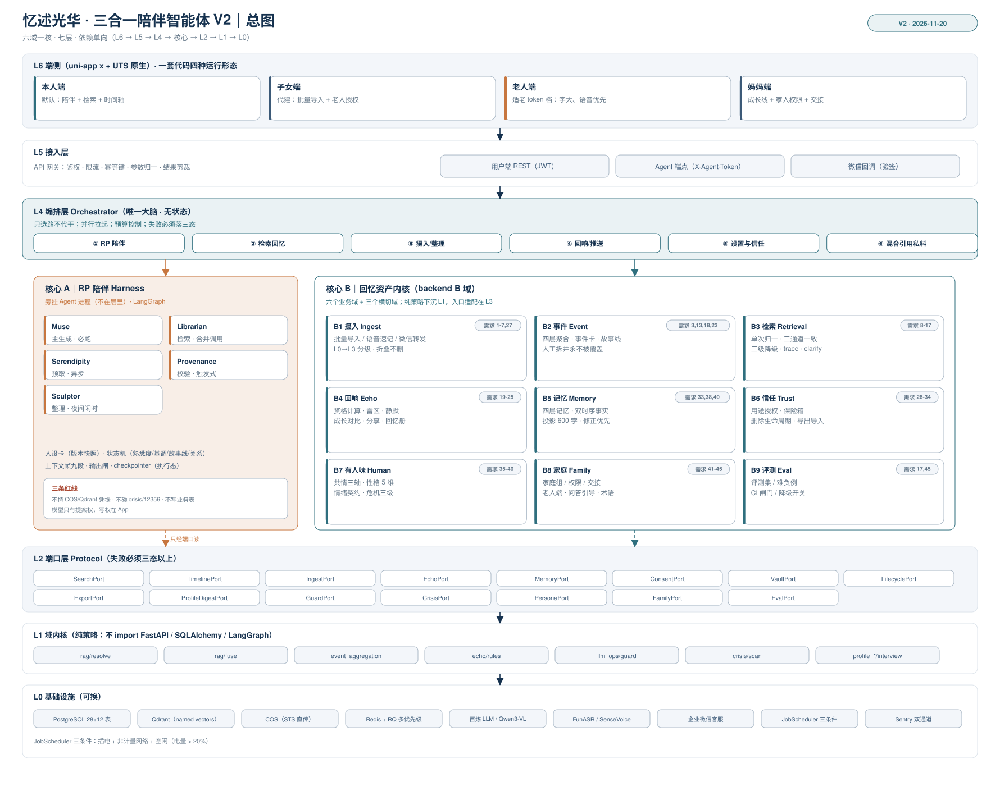

> 十二张图的矢量源与 PNG 预览都在 `docs/架构图/`（SVG 可无损缩放、可直接改文字；PNG 在 `架构图/png/`，长边 3000–4000 px）。图 01 总图 / 02 链路 / 03 五 Agent 分工 / 04 摄入分级 / 05 删除生命周期 / 06 检索降级链，07–12 是"Linger 范式对比 + 五只 Agent 各自的内部 harness"。生成脚本 `架构图/_gen.py`（纯 Python 手写 SVG，改文字改布局后 `python3 _gen.py` 重出）。

### 3.2 一次请求怎么走（耗时与降级）

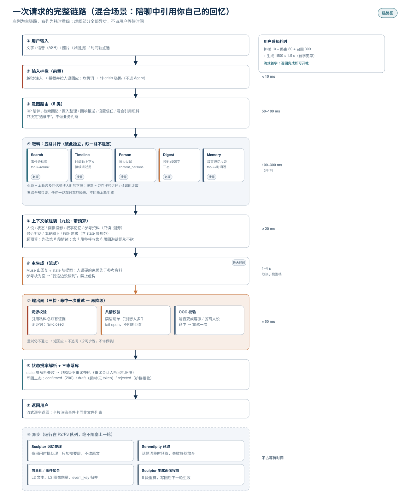

看图要抓三个数：**召回是并行的（100–300 ms 三者同时发，不是叠加）**；**生成是唯一的大头（1–4 s，流式首字可提前吐）**；**记忆整理与向量化全在 P2/P3 队列，不占用户等待时间**。这三条决定了"要不要为了省 200ms 去砍检索质量"这类取舍的答案。


---

## 四、核心 A：RP 陪伴 Harness（保留 + 语义改造）

### 4.1 角色卡（Role Card，结构化，不是一段 system prompt）

```json
{
  "role_id": "ayi_memory_companion",
  "display_name": "阿忆",
  "archetype": "memory_companion",     // 另外可选：storyteller / family_album_guide / grandchild_proxy
  "traits": {"warmth": 0.8, "humor": 0.2, "directness": 0.4},
  "speech": {"sentence": "short", "emoji": false, "address": "{{preferred_name}}"},
  "taboo": ["别想太多", "你为什么这样", "怀念吗", "你应该"],
  "stance": {"advice_first": false, "ask_before_advice": true, "diagnose": false},
  "memory_policy": {"may_read_private": true, "may_read_face_result": false},
  "version": "1.3", "snapshot_at": "2026-11-20T10:00:00+08:00"
}
```

要点：
- **版本化 + 快照回滚**：人设不许被记忆写歪（原稿红线 2 "人设优先级高于资料内容"在本版继续生效）。
- **多角色并存**：老人端默认 `grandchild_proxy`（更慢、更短、更多复述确认），本人端默认 `memory_companion`。
- **禁忌清单可回归断言**（与需求 35 的禁语、需求 22 的"怀念吗"同一份清单，单一来源）。

### 4.2 状态机（字段形状不变，语义替换）

| 原字段 | 本版字段 | 取值 | 谁写 | 用途 |
|---|---|---|---|---|
| 好感度 | **熟悉度 familiarity** | 0-100，分段：生疏/熟络/亲近 | Sculptor 离线按互动密度提升 | 决定称呼、玩笑尺度、主动关心强度 |
| 情绪状态 | **情绪基调 tone** | calm/warm/playful/gentle/quiet | Muse 输出 state 块，Harness 校验后落地 | 决定语气，不许每轮乱跳（相邻轮漂移上限） |
| 剧情 Flag | **故事线进度 arc** | 未开启/讲述中/已整理 | 事件域与用户确认驱动 | RP 的"剧情"= 一段回忆的讲述进程，可停在任意节点 |
| 关系等级 | **关系类型 relation** | 本人/子女/长辈/伴侣（由家庭域给出） | 家庭域注入，Muse 只读 | 决定"能不能替你决定""能不能提某个人" |
| — | **雷区快照 taboo_snapshot** | 词/人/日期段 | 信任域推送 | 每轮注入前先过滤 |

状态变更走**两阶段**：Muse 只出 `state` 块提案 → Harness 校验（边界、漂移、雷区）→ `MemoryWritePort` 落库。**模型永远无直接写权**（原稿红线 3 保留）。

### 4.3 五个 Agent 的触发条件与成本档（决定它是否值得跑）

| Agent | 何时跑 | 模型档 | 失败后果 | 降级 |
|---|---|---|---|---|
| Muse 主生成 | 每轮 | 主力（qwen-plus 级） | 无回复 | 模板化安全回复，不假装思考 |
| Librarian 检索 | 涉回忆/需事实 | 轻量 + 检索器 | 找不到 | 走三级降级链，不编 |
| Serendipity 预取 | 空闲、检测到话题漂移 | 轻量、异步 | 预取空 | 静默放弃，不影响本轮 |
| Provenance 校验 | 触发式：引用私料 / 敏感话题 / 用户纠错 / 危机词 | 轻量 | 校验不可用 | **fail-closed 只在"引用私料"场景**；普通对话 fail-open |
| Sculptor 离线整理 | 夜间闲时批 | 中档、批量 | 整理失败 | 保留原始，次日重试；绝不改写原文 |

> 这条表就是"成本闸"：五 Agent 全量每轮跑 = 单轮 4 次 LLM 调用，不可接受。**触发式**是本版对原稿最实际的一处修正。

### 4.4 上下文帧（最终版，含隔离与投影）

```text
# 0 全局约束（最高优先，不可被后续区块覆盖）
你在陪伴一位用户回顾他自己的记忆。保持人设与语气，禁止 OOC、禁止说教、禁止下诊断。
涉及回忆内容必须完全基于【参考资料】区块；区块为空时按人设自然地说"我这边没有翻到"，禁止虚构。
禁止输出内部字段（ID、时间戳、分数、置信度、表名）；把一切转成自然语言。
禁止替用户解释他的情绪；情绪解释权归用户。

# 1 人设（硬设定，版本快照）
{{role_card}}

# 2 状态（熟悉度/基调/故事线/关系类型/雷区快照）
{{state}}

# 3 画像投影（backend 渲染，≤600 字，8 段固定顺序；三态：ok / insufficient_data / unavailable）
{{profile_digest}}

# 4 叙事陪伴记忆（对话事件、印象、故事线段落）
{{rp_memory}}

# 5 参考资料（检索命中才注入；只读、带溯源；不是记忆，禁止写回）
[事件 card_id=... | 时间 | 地点 | 涉及人 | 摘要 | 素材清单]
{{private_reference}}

# 6 最近对话
{{chat_history}}

# 7 本轮输入
用户：{{user_input}}

# 8 输出要求
1) 先接住情绪再回应内容；给建议前先问"要不要听我说两句"；
2) 引用回忆时柔和融入，不罗列文件名、不报分数；
3) 找不到时给可执行出口（换词/翻时间轴/按人找），不给冷空结果；
4) 结尾附状态块（仅供 Harness 解析，用户不可见）：
```state
{"tone":"gentle","familiarity_delta":0,"arc":"讲述中","flags":[]}
```
```

**三个容易做错的地方（写进评审清单）**：
1. 画像投影是 `insufficient_data` 时**必须注入一行说明**（"该用户尚未提供画像，不要假装了解他"）——**空注入会让模型自由发挥**，用户会觉得"它乱认我"。
2. 参考区块要**带溯源**，否则后置校验无从下手。
3. `state` 块失败只降级、不重试整轮——重试会把"角色还在说话"变成"机器在调试"。

### 4.5 OOC 与幻觉的三道闸

| 闸 | 位置 | 判定 | 处置 |
|---|---|---|---|
| 闸 1 输入护栏 | 进 Harness 前 | 越狱/诱导/prompt 注入 | 拦截并按人设回应拒绝（不生硬） |
| 闸 2 生成约束 | 上下文帧 | 参考块只读、禁编造、禁诊断 | 模型层约束 |
| 闸 3 后置校验 | 出 Harness 前 | `empathy_violations`（禁语）、`provenance_check`（引用是否有证据）、`ooc_check`（是否脱离人设/变成客服） | 命中 → 一次重试（带修正提示）→ 仍命中 → 降级为"短回应 + 不追问" |

**闸 3 是 fail-open，只有三种情况 fail-closed**：引用私密资料无溯源、疑似危机信号、涉及未成年人不当内容。

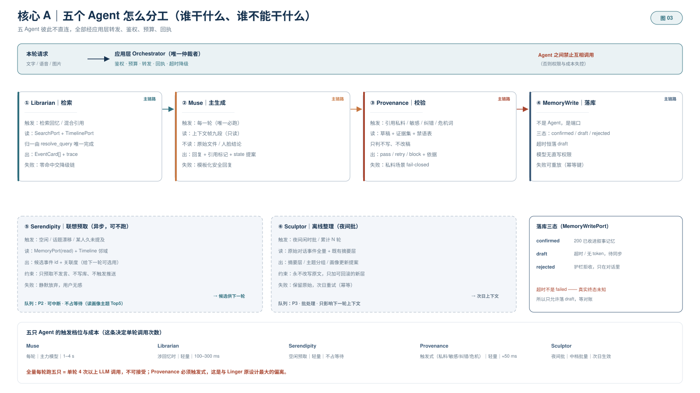


---

### 4.6 五只 Agent 各自的内部 Harness（对照 Linger 的做法）

前面 §4.3 只说了"谁在什么时候跑、贵不贵"，这一节说的是"跑起来之后，它内部被什么框住"。这两件事必须分开写，因为**权限不是写在提示词里的，是写进 harness 里的**：模型只能做它被允许做的事，而不是"被告知不要做"。

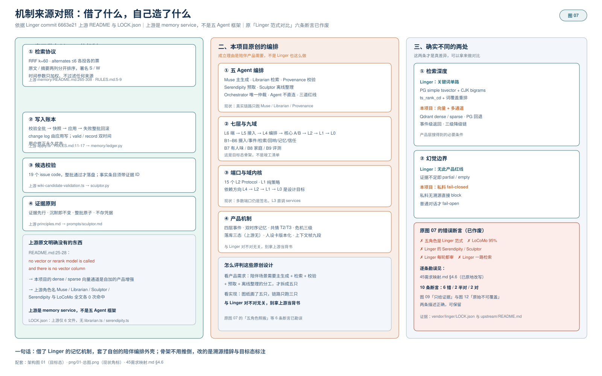

我们照搬 Linger 的四点：五角色分工、应用层单一仲裁（Agent 之间不直连）、提案→审核→落库两阶段写、原始不可覆盖。刻意改掉五点：Provenance 改触发式（省 3 次调用）、检索不再只有一路（Qdrant / PG 回退 / PG 精确三通道）、幻觉边界更硬（私料无溯源直接 block）、多出事件聚合与回响两个域、记忆落地不引外部服务（抽象 `MemoryPort`，落地 PG + Qdrant）。

**每只 Agent 都用同一个 harness 模板（五件套 + 三个契约面）**

| 面 | 内容 | 为什么必须有 |
|---|---|---|
| ① 角色与提示 | 人设/职责的一段冻结文本 + 全局禁令 | 换模型不改行为，只换 executor |
| ② 可用工具 | 白名单，且**默认空集**：没列出的工具不存在 | 越权是架构问题，不是模型品德问题 |
| ③ 内存视图 | 它**能看见**什么（窗口、投影、候选池），明确"看不见什么" | 五只共用一份上下文 = 隔离失效 |
| ④ 约束与闸 | 只读性、必须带 `card_id`、禁语内联、超预算先砍哪一段 | 事后校验救不了已经说出口的话 |
| ⑤ 循环与预算 | 允许几步、能不能重试、超时怎么退 | 单轮成本上限在这里被钉死 |
| 输出契约 | 结构化字段（不是自然语言），下游只认字段 | 让"落库/校验"不依赖模型自觉 |
| 失败语义 | ≥ 三态：可重试 / 终态失败 / 真实未知（`draft`） | 二态会把"超时"误判成"失败" |
| 成本档与队列 | P0 前台 / P2 空闲 / P3 夜间 | 决定它能不能占用户等待时间 |

**逐只落地（差异都在"工具"和"内存视图"这两格）**

| Agent | 工具白名单 | 内存视图 | 硬约束 |
|---|---|---|---|
| Muse（主生成） | **零写工具**；只可产"建议卡"（打开时间轴 / 按人找 / 分享） | 上下文帧九段 + 画像投影 ≤600 字 + 参考块 | 引用必须带 `card_id`；单轮只调一次；重试权不在它手上 |
| Librarian（检索） | `search` / `timeline` / `person` 过滤 / `rerank`；`resolve_query` 唯一一次归一 | 近 3 轮检索缓存（同 query 不重复打库）；不留跨会话结果 | 只返回证据不生成结论；三条通道必须吃同一份 filters（否则分面静默失效） |
| Serendipity（预取） | topic 相似度、候选池读写、TTL 管理；**无发言、无推送** | 只存 `id + 关联度`，不存原文；候选池容量上限 | 失败静默放弃，用户无感；同一主题每日最多预取一次 |
| Provenance（校验） | 只读证据集 + 禁语表；**只判不写、不改稿** | 草稿 + 证据集 + 本次触发的判据 | 私料无溯源 fail-closed；普通对话 fail-open，不阻断回复 |
| Sculptor（离线整理） | 摘要、主题聚类、去重、画像提案；**无删除、无改原文** | 批窗口（如 30 天）内的对话与事件 | 只加可回滚的新层；幂等键保证重跑不重复产出；冲突不覆盖，并列保留并标"待确认" |

**五张内部结构图（同一模板，五套不同的边界）**

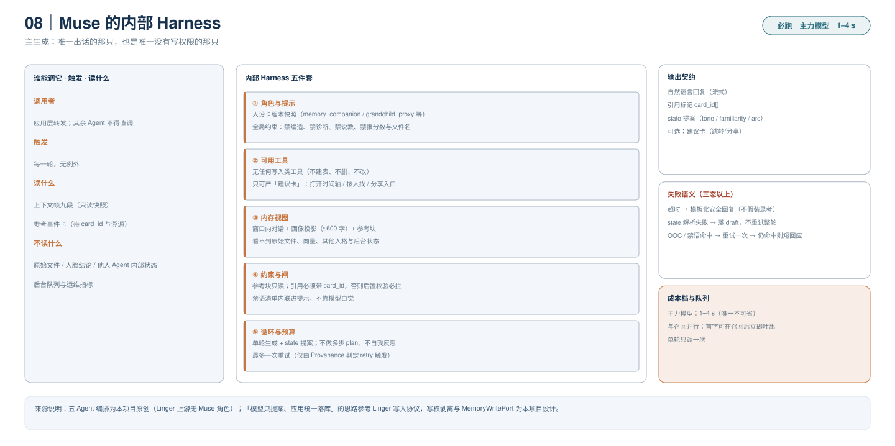

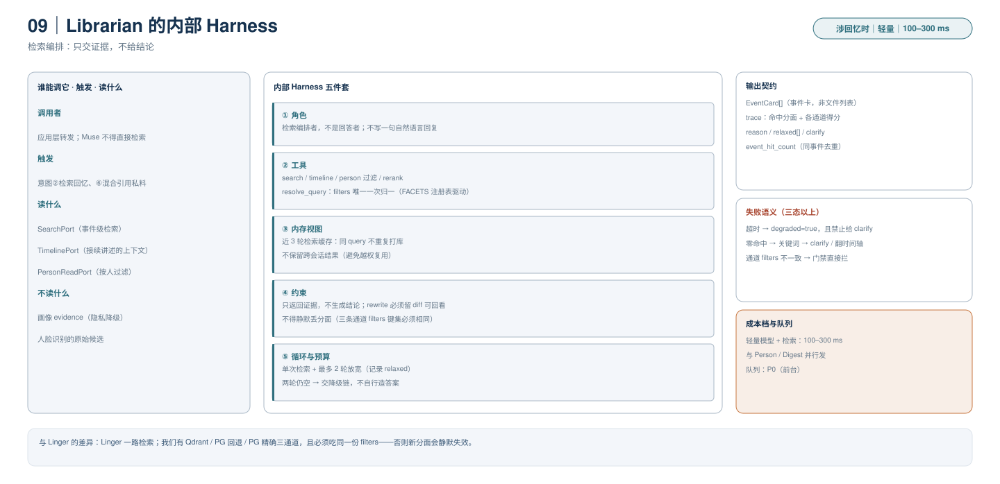

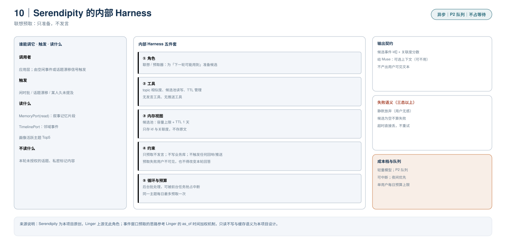

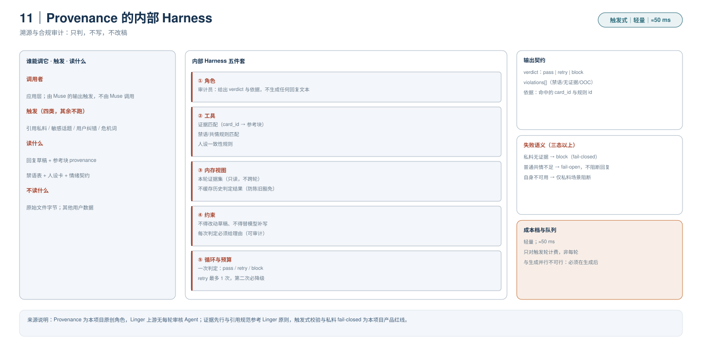

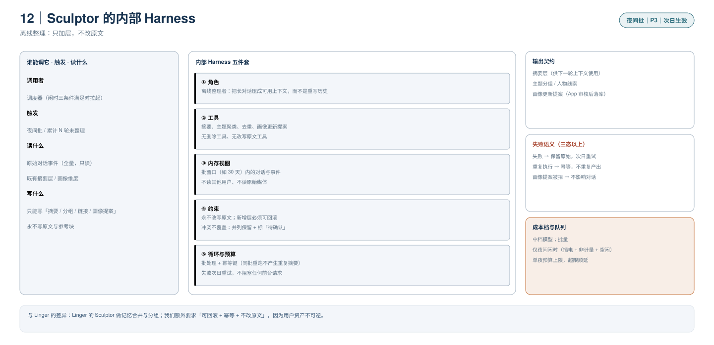

**一条判据**：如果某只 Agent 的"内存视图"里出现了它职责之外的东西（比如 Muse 看得到原始文件、Librarian 看得到别人的人格状态），那不是配置错误，是隔离被破了——这类 bug 在灰度里查不出来，只会在"它怎么知道这个"的用户投诉里爆出来。

---

## 五、核心 B：回忆资产内核（六域）

### 5.1 B1 摄入域 Ingest

**目标**：把"导入 5000 张照片 = 556 次操作"变成"一次授权 + 一次确认 + 后台跑完"，且用户随时知道"到哪一步了"。

**状态机（内容级，两个现有字段就够，零新表）**

```text
[收到] status=uploaded, index_level=L0    → 时间轴可见（可翻）
  │ 生成缩略图（端侧或服务端）
  ▼
[可看] index_level=L1                     → 缩略图可看
  │ RQ 异步：ASR / OCR / VLM caption
  ▼
[可搜] index_level=L2, text 非空          → 文本检索可命中
  │ RQ 异步（最后）
  ▼
[可图搜] index_level=L3, image_vec 非空   → 以图搜图 / 相似内容
```

**四条硬规则**：

1. **`skip existing library` 必须删除**。它导致整批导入被一句话堵死，是"导入了"这句假话的根因。改为：按 `MediaStore` keyset 分页枚举 + 本地"设备内文件身份键"（原 `perceptual_hash`，改名避免暗示 pHash 能力）去重 → 只跳过真正同一文件。
2. **`status=done` 但 `text` 为空不许算完成**。完成判定 = 该级产物非空；否则退回 `L1` 并计入重跑队列。
3. **折叠 ≠ 删除**。重复/截图/废片的处置是 `fold_group_id` + `folded=true`，原始文件永久保留，用户一手可展开。
4. **进度必须分三档呈现**："已收到 5000 · 可翻；其中 1200 可搜；余下 3800 今晚闲时跑完"。单一百分比条属于假状态（它无法表达"能翻不能搜"）。

**批量导入编排**：`ingest_job` 表记录 `total/skip/fold/queued/done/failed`，游标推进，断点续传；客户端分片 + 服务端 STS 直传（不经过 API 转发原图）。

**微信**：只有一条路径——用户主动转发 → 企业微信"微信客服"回调 → `create_content`。**架构上不存在"读取会话列表"的端口**（不是关了开关，是没有这个能力）。

**为什么这里一度叫"状态机"，最后画成"分级"（读图说明）**

"状态机"这个词在图 04 里只指一件事：**一份资产有四个可见级别，而级别只能往上爬、每一级的完成判据不同**。它不是"一个 `status` 字段从 `uploaded` 走到 `done`"的那种四态机——那正是历史上假状态的源头：

- 一个 `status` 字段扛不了四种含义。用户问"我能搜到吗"、系统问"文本抽取完了吗"、运维问"这批跑完了吗"，三个问题被压进一个枚举值，任何一个答案都会骗到另外两个人。
- 长事务不能有"进行中"这种含糊态。5000 张照片要跑小时级，中间断电、切网、后台被杀都是常态；只要允许"进行中"，崩一次就永远停在"进行中"。
- 所以拆成四个**独立完成、独立重跑**的产物：`L0 行存在` / `L1 缩略图可取` / `L2 text 非空` / `L3 向量可查`。每一级有自己的判定式，失败只退回这一级，不用整批重来。

**真正需要"状态机"的地方只有一处：删除**（图 05）。因为删除不可逆、且必须能向用户证明"四层都清了"，那里才需要显式的 `requested → deleting → purged / failed` 加 30 天倒计时。摄入是可逆的（重跑即可），删除是不可逆的——**状态机的成本应该花在不可逆的地方**。

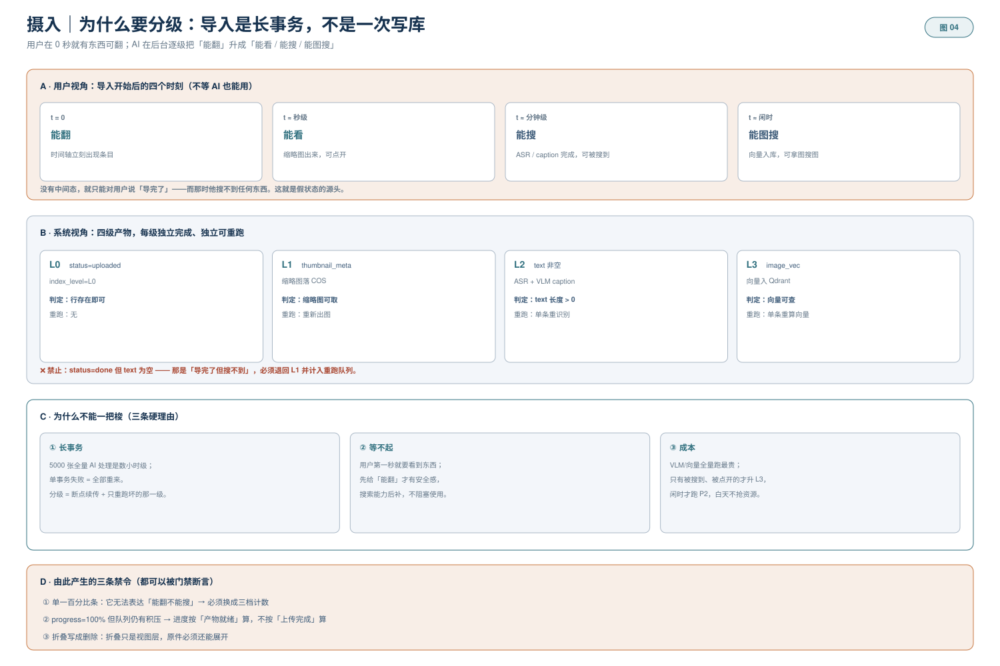


### 5.2 B2 事件域 Event

**四层聚合**（沿用现有 ST-DBSCAN 思路，补两层语义）：

| 层 | 定义 | 粒度 | 服务于 |
|---|---|---|---|
| L1 内容 | 单张照片 / 单条语音 / 单条文字 | 素材 | 1,2,3,5 |
| L2 会话 | 同一地点 + 短时间窗的连续素材 | 半自动 | 13,18 |
| L3 事件 | 可命名的一件事（"那次吃火锅"） | 自动 + 用户确认 | 8,13,14,18 |
| L4 故事线 | 事件序列（"小宝 0-3 岁"） | 用户/时间驱动 | 18,23,44 |

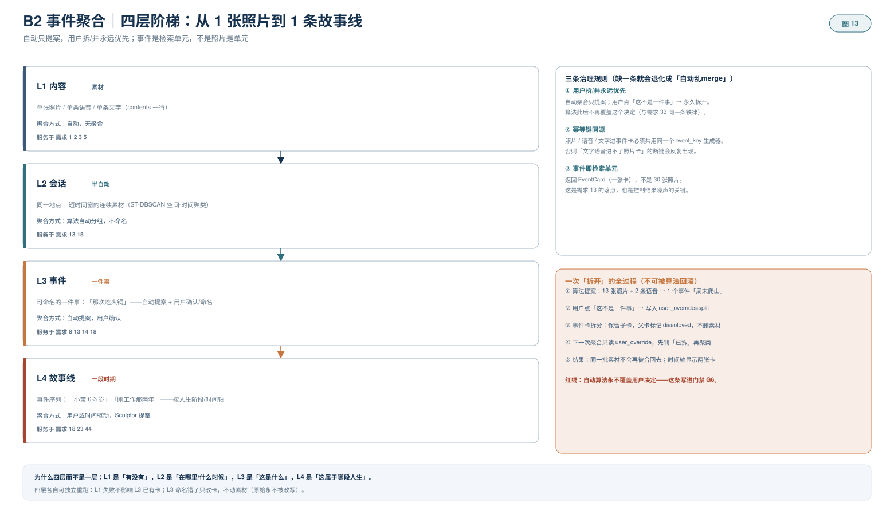

**三条治理规则**：
- **用户拆/并永远优先**：自动聚合只提案，用户点"这不是一件事"就永久拆开，算法不覆盖（与需求 33 同一条铁律）。
- **幂等键同源**：照片、语音、文字进入事件卡必须用同一个 `event_key` 生成器，否则"文字语音进不了照片卡"这类断链会反复出现。
- **事件即检索单元**：搜 "吃火锅那次" 返回一张事件卡，而不是 30 张照片。这是需求 13 的落点，也是控制结果噪声的关键。

### 5.3 B3 检索域 Retrieval

**一次归一，三条通道吃同一份 filters（这是本域最严重的既有缺陷，必须同批修）**

```text
SearchQuery
   │  resolve_query()  ← 唯一一次归一（FACETS 注册表驱动）
   ▼
ResolvedQuery{filters, channels[], intent, degrade_plan}
   ├→ Qdrant 通道      (vector + payload filter)
   ├→ PG 回退通道      (pg_fallback)
   └→ PG 精确/关键词通道 (pg_exact)
```

**FACETS 单一注册表**（加一个分面只改一处，不再改 4 处）：

| 分面 | 字段 | 数据来源 | 备注 |
|---|---|---|---|
| 人 | `person_id[]` | `content_persons`（用户手输人名，非 NER 猜测） | 需求 15 |
| 关系/多人 | `person_ids` 组合 | 同上 | "我和某某" |
| 时间 | `time_from/time_to` + 相对时间解析 | `contents.event_time` | "去年/那次/第一次"进降级链 |
| 地点 | `place` | exif/逆地理/用户改 | 宽松前缀匹配 |
| 分类 | `content_types`, `content_class` | 分类器 | 需求 4 |
| 视觉属性 | `color/action/scene` | VLM caption 派生标签 | 需求 9 颜色/动作，本版**可做**（不再"数据源不存在"，因为 caption 就是数据源） |
| 情绪 | `valence/arousal` 区间 | 情绪契约 | 只做区间，不做判词 |
| 关键词 | `keyword` | 全文索引 | 需求 11 |

**三级降级（不许给空结果）**

```text
AI 语义检索（vector+dense+sparse+rerank）
   ├ 命中 → 返回事件卡 + trace
   ├ 弱命中 → relaxed 告知"已放宽『分类』条件，找到 3 条"
   ├ 零命中 → 关键词通道（mode=keyword）
   └ 仍零命中 → clarify（grounded 反问：选项来自真实 facet 值，如"是『青岛』还是『三亚』"）
                或 引导翻时间轴（给到月份级跳转）
```

**三条约束**：
- `degraded=true` 时**禁止给 clarify**（把"系统挂了"说成"你再说清楚点"是最恶劣的一种假状态）。
- clarify 的选项**只能来自数据库真实值**，禁止 LLM 生成（防止引导用户去搜不存在的东西）。
- 每个命中必须带 `trace`：命中哪些分面、各通道得分、来源（照片/语音/文字）。

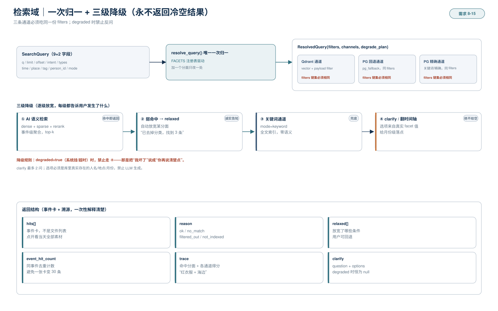


### 5.4 B4 回响域 Echo（需求 19-25 的落点）

**把"推不推"做成可测函数，而不是 prompt 文案**：

```text
eligible(user, date) =
  within_window(today, anniversary_rules)      // 去年今日 / 生日 / 节日
  AND has_asset(date, ±N天)
  AND NOT excluded(person/pet/date_range/word) // 需求 20
  AND NOT quiet_hours(now, pref)               // 需求 25
  AND NOT over_frequency(user, 7d)             // 频率上限
  AND NOT dismissed(content_id)                // 需求 20 单条不再显示
```

| 组件 | 职责 | 契约 |
|---|---|---|
| 资格计算 | 纯函数，可单测 | `EchoPort.eligible()` / `EchoPort.today()` |
| 雷区过滤 | 人/宠物/日期段（SQL 下推）+ 词（复用 `profile_sensitive`） | `echo_exclusion` + `profile_sensitive` |
| 静默时段 | `in_quiet_hours()` 纯函数，跨时区 | `echo_preference.quiet_*` |
| 通道 | `channel` 恒 `in_app`（需求 19：默认克制） | G9 断言 |
| 文案 | 禁"怀念吗/还记得吗"式诱导；分享是可选入口不是 CTA | 文案库 + G10 |
| 成长模式 | 月龄/第一次/同场景跨年（需求 23） | `growth_milestone` + 妈妈端 |
| 分享/回忆册 | 卡片分享 / 专辑生成（需求 24） | `share_link` + 渲染服务 |

**关键取舍**：推送的真实通道内测期是 mock。架构上仍建 `push_log` 与 `channel` 字段，但**对外只承诺 in_app**——不做"已推送"的假状态。

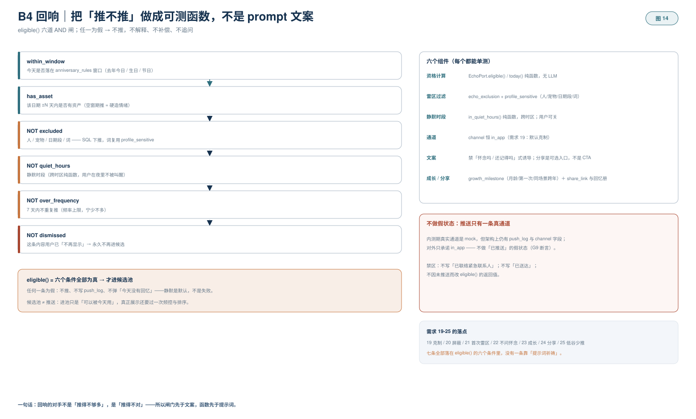

### 5.5 B5 记忆域 Memory（四层）

| 层 | 存什么 | 写入者 | 读取者 | 存储 | 保留 |
|---|---|---|---|---|---|
| ① 叙事陪伴记忆 | 对话事件、印象、故事线段落、情绪脉络 | Sculptor（离线）、Muse 提案 | Muse / Librarian | PG `memory_episode` + Qdrant | 长期，可摘要压缩 |
| ② 用户事实记忆 | 称呼、家人、人生阶段、偏好、重要日期 | 画像标注 + 用户确认 | ProfileDigest 投影 | PG `user_profile` + `profile_dimension_history` | 长期；双时序 |
| ③ 资产索引 | 素材元数据、caption、向量 | 摄入管线 | 检索 | PG + Qdrant + COS | 随内容生命周期 |
| ④ 偏好与修正记忆 | 雷区、AI 性格、情绪解释开关、用户纠错 | 用户显式操作 | 全局（先于任何生成） | PG `preferences` / `correction_log` / `user_ai_persona` | 永久，**优先级最高** |

**旧版"三层记忆"去哪了（版本对齐，逐条对应）**

上一版（三合一架构定稿）写的是"子系统 3：长期记忆体系（三层）"。那三层在本版是 B5 的 ①②④，并额外拆出 ③：

| 旧版三层 | 本版落点 | 变化 |
|---|---|---|
| 第一层 陪伴叙事记忆（RP 记忆） | **B5 ① 叙事陪伴记忆** | 保留。写入者写明为 Sculptor（离线整理）+ Muse 提案；写入口统一走 `MemoryWritePort` 三态 |
| 第二层 用户事实记忆（Mem0 / 时序图谱双方案） | **B5 ② 用户事实记忆** | 保留。Mem0 降为"抽取-合并"的思路来源、Graphiti 只借双时序字段，落地 PG（ADR 已判负：不引其服务） |
| 第三层 用户偏好与修正记忆（雷区 / AI 修正 / 功能偏好） | **B5 ④ 偏好与修正记忆** | 保留并升为**最高优先级**；同时被 B4（雷区 → `echo_exclusion`）、B6（`correction_log`）、B7（情绪开关 / `PersonaPort`）复用同一份数据 |
| （本版新增）资产索引 | **B5 ③ 资产索引** | 多模态资产（照片 / 语音 / 文档 / 公众号文章）必须单独一层，否则"找得到"没有索引可查——这是旧三层缺的那一层 |

**那句铁律（用户修正 > AI 自动生成）落在四个地方**：④ 层本身是唯一写入口径；读取顺序把 ④ 排第一（先于任何生成）；B2 的"用户拆/并永远优先"；B6 的写三态（`confirmed / draft / rejected`）。四处任缺其一，铁律就会退化成一句口号。

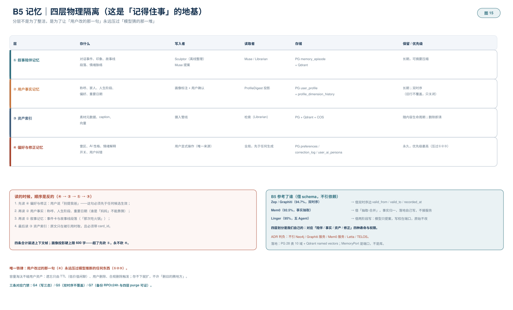

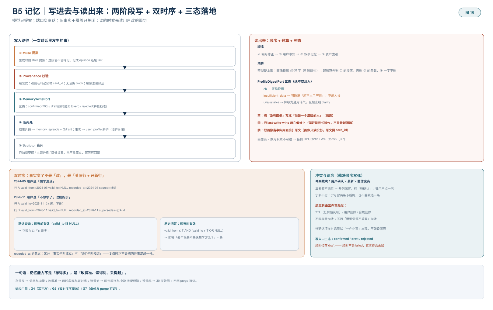

**双时序事实（借 Graphiti 的 schema 思想，不引依赖）**：
`user_profile` 维度行加 `valid_from / valid_to / recorded_at`。
- 事实变更 = 旧行 `valid_to=now`、新行插入，**不覆盖**；
- 查询默认读"当前有效"，历史问答可读"当时有效"（"我去年是不是说想学游泳？"）。

**冲突与遗忘**：
- 冲突 → 用户确认 > 最新 > 置信度高；前三者都不满足则并列保留（宁多不忘，但要标"待确认"）。
- 遗忘 → 只由 TTL（低价值闲聊）、用户删除、合规删除触发；**不因容量淘汰用户资产**。

### 5.6 B6 信任域 Trust（需求 26-34 的落点，本版最硬的一块）

```text
ConsentPort   用途授权：biometric_face / voiceprint / training_use / cloud_storage
             默认全 false；开启需明示；关闭即删派生特征
VaultPort     保险箱：端侧密钥 + 服务端零知识；无密码不可解；免费
LifecyclePort 删除：users.status='deleting' → 202 回执 → 30 天可撤销 → purge
              purge 顺序：PG 硬删提交 → Qdrant → COS → memory schema
ExportPort    导出：游标分页 + ZIP（语音/文本/元数据）+ 照片 COS 直链 + manifest
ImportPort    导入：校验 manifest 版本 / 路径穿越 / 解压后总字节 → 才允许写
TrainingGate  训练：任何训练集导出必须过 gate，列出"已排除用户"清单可审计
```

**四个不许出现的假状态**：
1. 导出只给元数据、2000 条截断不告知 —— 必须回 `truncated=true` 并给续拉游标。
2. `cleanup_job --dry-run` 挂在生产 —— 摘掉；`purge_status` 只允许 `done/failed`（不要 `pending` 这种"永远不知道"的值）。
3. "只分析不训练"写进协议但纠错文本进训练集 —— 要么改行为，要么改文案，二选一，不许两者并存。
4. 首屏写"数据存在 SQLite"但客户端根本没有 —— 事实性表述必须与实现一致。

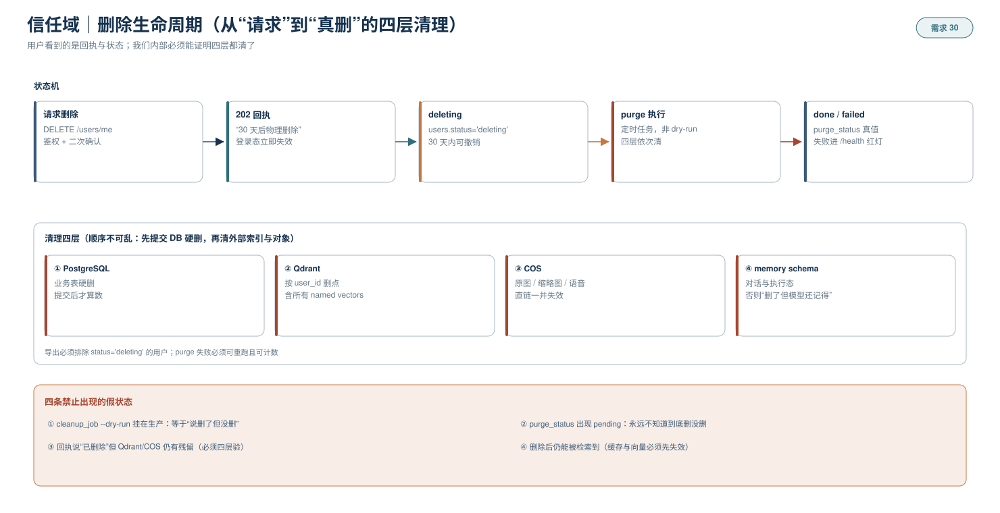


### 5.7 B7 有人味域 Human

| 能力 | 实现 | 契约 | 需求 |
|---|---|---|---|
| 共情优先 | prompt 三轴（情绪命名 / 承认 / 不评判）+ 禁语清单 | `empathy_violations()` 纯函数，fail-open | 35 |
| AI 性格 | 5 封闭维度（warmth/verbosity/advice/tone/emotion_display），middleware 拼装，**不改进程单例 prompt** | `PersonaPort` | 36 |
| 情绪描述 | `{valence, arousal, cues[], basis}`；**无 confidence 字段**（契约里就没有） | API schema + 客户端 UTS 删字段（编译期拦） | 39 |
| 情绪解释权 | 可关/可改/可纠正，`correction.field=emotion` | `CorrectionPort` | 40 |
| 危机 | T3 硬停不进 Agent；T2 表留空；T1 注入三轴 | `CrisisPort` + `crisis_events.record_status` | 37 |

**危机铁律**：不写"已联络紧急联系人"字段——**联络不了**。只留 `escalation_note` 记录真实做过的事（给了号码/提示了 AI 身份/留了痕）。

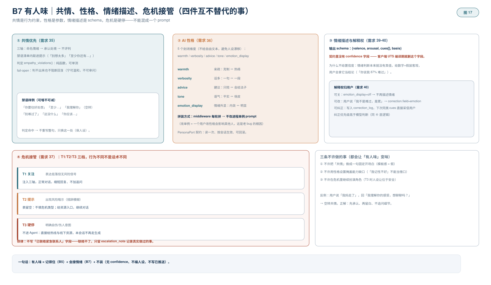

### 5.8 B8 家庭域 Family（需求 41-44）

```text
family_group (id, owner, name)
family_member (group_id, user_id, role: owner|editor|viewer, scope: all|album|event)
handoff_log  (from, to, object, at)   // 妈妈端"交接给爸爸"
```

- **可见性最小化**：默认 `viewer` 只能看被显式共享的事件/相册，不能全库。
- **老人端 = 同一 App 的受限形态**：字号档位（`var()` token 重写）、大按钮、语音优先、关键动作二次确认、**任何涉钱入口不存在**。
- **问答引导（需求 43）**：`interview_session` 按人生阶段（儿时/求学/工作/家庭）出题 → 用户口述 → ASR → 写入 `contents`（不是只写画像）→ 进事件聚合 → 时间轴不空。
- **术语（需求 45）**：术语表单一来源，G10 第 5 轴断言（禁"整理/清理/删除"，用"精选/回忆/故事"）。

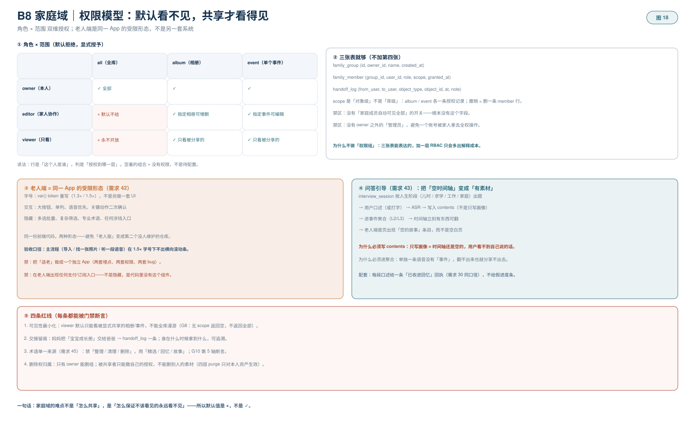

---

## 六、契约清单（失败必须三态以上）

### 6.1 Agent ↔ backend（4 个端点）

| # | 端点 | 成功 | 失败语义 |
|---|---|---|---|
| A1 | `POST /api/v1/search/agent` | 200 `SearchResult{reason, relaxed, clarify, event_hit_count, trace}` | 503 未配 token（fail-closed）/ 401 / 422；**`degraded` 必须原样透传** |
| A2 | `POST /api/v1/contents/agent` | 200 + `{confirmed}` | 409 重复 / 422 护栏拒收（是策略不是故障）/ 超时→`draft` |
| A3 | `DELETE /contents/agent/by-cgid/{cgid}` | 200 `{deleted}` 幂等 | 503 / 401 |
| A4 | `GET /api/v1/profile/agent/digest` | `{status: ok|insufficient_data|unavailable, text, chars}` | 永不因"没画像"返 4xx |

### 6.2 端口表（12 个）

| 端口 | 签名要点 | 三态 |
|---|---|---|
| `SearchPort` | `search(SearchQuery) -> SearchResult` | ok / no_match / not_indexed / degraded |
| `TimelinePort` | `page(cursor, scope) -> TimelinePage` | ok / empty / unavailable |
| `IngestPort` | `enqueue(job) -> job_id`；`progress(job_id)` | queued / running / partial / done / failed |
| `EchoPort` | `eligible()` / `today()` | ok / suppressed(reason) / no_candidate |
| `MemoryPort` | `read/write/propose` | ok / conflict / rejected / unavailable |
| `ConsentPort` | `get/set(scope)` | ok / not_granted / revoked |
| `VaultPort` | `lock/unlock/list` | ok / locked / wrong_key / unavailable |
| `LifecyclePort` | `request_delete()` / `purge_status()` | scheduled / purging / done / failed |
| `ExportPort` | `cursor page` | ok / truncated / failed |
| `ProfileDigestPort` | `digest(user)` | ok / insufficient_data / unavailable |
| `GuardPort` | `check(text)` | allow / mask / reject / handoff |
| `EvalPort` | `run_eval(dataset)` | pass / warn / fail / unavailable |

### 6.3 契约三条铁律（沿用并加严）

1. 按**最全调用方**定义（Agent 拿子集，但不许把子集当契约）。
2. 适配器只收敛**呈现**，不收敛**能力**。
3. 失败至少三态；**任何"一个值扛三件事"的返回都要拆**（`hits=[]` 不许同时表示"没匹配/没索引/系统挂"）。

---

## 七、数据模型增量

### 7.1 现有（微改）

| 表 | 改动 | 服务需求 |
|---|---|---|
| `contents` | 加 `purge_status`；`extra.index_level/folded/fold_group_id`；`event_key` | 1,5,7,30 |
| `content_persons` | `valid_from/valid_to` + `epistemic`（用户确认 vs AI 提案） | 15,16 |
| `events/event_items` | 不动结构，补 `event_key` 唯一约束 | 13,18 |
| `user_profile` | 加 `valid_from/valid_to/recorded_at` | 38 |
| `messages/chat_messages` | 加 `crisis`、`field` | 37,40 |
| `echo_history` | 不动（`suppressed` 不落行） | 19,20 |
| `users` | 加 `preferred_name`、`status='deleting'`、`age_bracket` | 26,30,38 |

### 7.2 新增（12 张）

| # | 表 | 域 | 用途 | 需求 |
|---|---|---|---|---|
| 1 | `persons` | 实体 | 人名（用户手输，非 NER 猜） | 9,15,16 |
| 2 | `content_persons` | 实体 | 内容↔人多对多（含时段有效） | 15 |
| 3 | `user_ai_persona` | 人格 | 5 维性格 + `emotion_display` | 36,40 |
| 4 | `crisis_events` | 安全 | 危机留痕（`record_status` 真值） | 37 |
| 5 | `echo_preference` | 回响 | 总开关 + 静默时段 | 19,25 |
| 6 | `echo_exclusion` | 回响 | 人/宠物/日期段（词走 `profile_sensitive`） | 20,21 |
| 7 | `ingest_job` | 摄入 | 批量导入任务与计数 | 1,7,27 |
| 8 | `export_job` / `import_job` | 信任 | 导出/导入任务、manifest、truncated | 31 |
| 9 | `family_group` / `family_member` / `handoff_log` | 家庭 | 家庭组、权限、交接 | 41,44 |
| 10 | `vault_item` | 信任 | 保险箱条目（密文 + 端侧密钥） | 32 |
| 11 | `consent_record` | 信任 | 用途授权（生物特征/训练/云存） | 28,29 |
| 12 | `growth_milestone` / `interview_session` / `push_log` / `search_eval_set` | 成长·引导·推送·评测 | 月龄/第一次、问答、推送留痕、评测集 | 23,43,25,17 |

> 说明：`search_eval_set` 也可以放 JSON 文件入库，但**要能进 CI**就必须有版本与基线，落表更稳。

---

## 八、门禁（每条都要负向探针，否则不算）

| # | 门禁 | 拦什么 | 需求 |
|---|---|---|---|
| G1 | backend 不得 import agent（AST） | 依赖反转 | 全局 |
| G2 | agent 环境不得有非空 COS/QDRANT 凭据 | 越权直连 | 全局 |
| G3 | agent 不得出现 `user_profile/persons/profile_sensitive` 表名 | 绕过投影 | 38 |
| G4 | agent 不得出现 `crisis/12356/handoff` | 危机链路必须在 App | 37 |
| G5 | `channel` 恒 `in_app`（AST） | 假推送 | 19 |
| G6 | 文案禁词第 5 轴（"怀念吗/整理/清理/删除/别想太多"） | 伤人话术 | 22,35,45 |
| G7 | 三条检索通道 filters 键集必须相同 | 静默失效 | 8,9,15 |
| G8 | `degraded=true` 时不得返回 clarify | 假反问 | 12 |
| G9 | 情绪契约不得含 `confidence` 字段（含客户端 UTS） | 假精确 | 39 |
| G10 | 索引分级完成判定：`status=done` 必须产物非空 | 假导入 | 1,7 |
| G11 | 导出 `truncated=true` 必须可达续拉 | 假导出 | 31 |
| G12 | Top3 评测进 CI（起步 WARN，达标后阻断） | 假指标 | 17 |

---

## 九、运行时与成本（"后台不常驻"是约束，不是功能）

```text
JobScheduler 三条件：charging && unmetered && idle(battery>20%)
队列优先级：
  P0 实时      ASR 短语音、检索、对话（前台，立即）
  P1 可感知    缩略图、分类、文本抽取
  P2 深度      VLM caption、向量化、事件聚合、画像标注
  P3 维护      purge、导出、备份、Sculptor 整理、评测重跑
```

**四道成本闸**：
1. **分级触发**：照片先 L1 缩略图，用户真的搜/看才升 L2/L3（不是全量 VLM）。
2. **批量合并**：同一事件的素材合批一次 VLM，而不是逐张。
3. **预算闸**：单用户日调用上限 + 全局熔断；超限排队而非降质。
4. **缓存复用**：事件摘要、caption、检索结果带 TTL 缓存；相似图片共享 caption 模板。

**可观测**：`/health` 输出 `ingest_backlog / purge_failed / crisis_record_failed / queue_lag / eval_top3`，任一项为红必须可见（不许"看起来都正常"）。

---

## 十、45 条需求 → 架构构件 映射矩阵

> 读法：**主承载**（层/域）→ **目标模块**（落点）→ **契约**（调谁）→ **数据结构**（存哪）→ **落地要点**（怎么算做完）
> 全部 45 条均有归属；原矩阵标"不做"的条目，本版按"能力可建、默认关闭"处理（架构保留，产品开关决定是否上线）。

### 组一：把记忆收进来（1-7）

| # | 需求 | 主承载 | 目标模块 | 契约 | 数据结构 | 落地要点 |
|---|---|---|---|---|---|---|
| 1 | 整批导入相册，不必先建文件夹打标签 | C 端 + B1 | `ingest/importer` + `api/ingest` | `IngestPort` | `ingest_job`、`contents.status/index_level` | 删 `skip existing library`；MediaStore keyset 分页；L0 立即可翻；断点续传；自动聚类只在导入末尾确认一次 |
| 2 | 按住说一句，自动转文字挂时间线 | C 端 + B1 | `voice/recorder`（UTS）+ `pipeline_audio` | `IngestPort` | `contents(type=voice)` + `asr_text` | 3 步（按住→松手→保存）；幂等键 `voice:<sha256>`；时长/采样率校验；失败可重录不丢 |
| 3 | 照片语音文字放一起收 | B1 | `create_content` 统一入口 | `MemoryWritePort` | `contents` 单表 + `content_type` | 单一入口四件套（护栏/幂等/变更日志/入队）；**读侧同卡渲染**（三类都能出现在事件卡，不许只有照片） |
| 4 | 导入时 AI 归类，只在导入时确认 | B1/B2 | `classifier`(SetFit) + `pipeline_tagging` | `IngestPort` | `contents.content_class` | 照片也走分类（现状漏）；确认卡只出现在导入流程末尾；浏览/检索零弹窗；先 20 张抽检 |
| 5 | 重复/废片/截图折叠不删 | B1 | `fold_rules`（截图 RELATIVE_PATH + 设备内文件身份键 + 相似度） | `IngestPort` | `extra.is_screenshot/folded/fold_group_id` | 只标折叠不删；"设备内文件身份键"改名（不再暗示 pHash）；废片判定阈值可配；用户可一键展开 |
| 6 | 微信只主动转发 | C | `wechat/service` 被动回调 | `IngestPort` | `contents(source=wechat)` | 无"读会话"端口（能力不存在）；回调幂等；转发内容同走 `create_content` |
| 7 | 进度/备份看得见 | C + B1 | `UploadStatusBanner` + `/health` | `IngestPort.progress` | `ingest_job` 计数 | 三档文案（收到/可翻/可搜）；失败数与重试入口可见；备份状态只报真实结果 |

### 组二：找得到（8-17）

| # | 需求 | 主承载 | 目标模块 | 契约 | 数据结构 | 落地要点 |
|---|---|---|---|---|---|---|
| 8 | 说人话就能搜 | B3 | `rag/resolve+rewrite+recall+fuse` | `SearchPort` | Qdrant payload + PG | `resolve_query` 单次归一；口语词表（"那次/有妈妈在"）；混合检索 + rerank |
| 9 | 懂人/关系/颜色/动作/心情/地点/相对时间 | B3 | FACETS 注册表 + caption 派生标签 | `SearchPort` | `content_persons` + caption tags | 人物走实体表；颜色/动作**由 VLM caption 派生**（不再说"数据源不存在"）；相对时间解析进降级链 |
| 10 | 搜和翻并存 | B3 + C | `search` 与 `timeline` 两条独立入口 | `SearchPort` / `TimelinePort` | — | 搜结果可跳时间轴定位；任一条挂了另一条仍可用 |
| 11 | 关键词切换 + 搜不到转翻 | B3 + C | `mode: auto/keyword/ai` | `SearchPort` | `SearchResult.reason` | 一键切换；转翻给月份级落点；切换状态可回退 |
| 12 | 搜不到先反问/引导 | B3 | `clarify` 生成器（grounded） | `SearchPort` | 现算不建表 | 选项来自真实 facet 值；`degraded` 时禁发；最多 2 问 |
| 13 | 结果按"一件事"给 | B2/B3 | `event_retrieval` | `SearchPort` | `event_items` | 事件为单元；`event_hit_count`；点开看当天全部素材 |
| 14 | 为什么命中 | B3 | `trace` 构造器 | `SearchPort` | 现有列 + 分面 | 输出"命中『红衣服』『海边』，来源照片 3 张"；不外泄内部权重 |
| 15 | 按人找 | B3 | `person_filter` | `SearchPort` | `content_persons`(period) | `person_id` 进 filters；多人和组合；NER 不再静默摘人 |
| 16 | 认老照片里的人 | B3/B7 | `FacePort`（默认关）+ 候选提案 | `PersonReadPort` | `persons` + `content_persons.epistemic` | **只给候选不给结论**；用户逐条确认；误认可回滚；开启需 Consent |
| 17 | Top3 用大白话测 | B9 | `run_eval` + CI | `EvalPort` | `search_eval_set` + 难负例 30 | 评测集版本化；负例防"全都召回"；CI 起步 WARN、达标阻断；降级开关联动 |

### 组三：看得回（18-25）

| # | 需求 | 主承载 | 目标模块 | 契约 | 数据结构 | 落地要点 |
|---|---|---|---|---|---|---|
| 18 | 时间轴按事串 | B2 | `timeline`（事件卡） | `TimelinePort` | `events/event_items` | 事件卡聚合图/音/文；**幂等键同源**（否则音文进不了卡）；高密度日可折叠 |
| 19 | 去年今日默认克制 | B4 | `echo/rules` + `api/echo` | `EchoPort` | `echo_history` | `channel` 恒 `in_app`；默认不弹系统通知；一天最多一张卡 |
| 20 | 屏蔽人/宠物/词/日期段/全关 | B4 | `exclusion_filter` | `EchoPort` | `echo_exclusion` + `profile_sensitive` | 人/日期 SQL 下推；词复用敏感表（不建第二份）；三处统一过滤：检索/时间轴/推送 |
| 21 | 首次雷区设置 | C + B4 | `onboarding_guardrails` | `EchoPort` | `echo_exclusion.reason` | 可跳过；默认最保守（宁可少推）；设置后立即生效可验证 |
| 22 | 不问"怀念吗" | B4 | 文案库 + G6 | — | — | 禁诱导式问句；分享是入口不是 CTA；文案进断言 |
| 23 | 育儿成长对比 | B2 + B8 | `growth`（月龄/第一次/同场景跨年） | `TimelinePort` | `growth_milestone` + `persons.birth_date` | 月龄算准（含闰年/生日当天）；"第一次"只在有证据时标注；妈妈端专属视图 |
| 24 | 一键分享/回忆册 | B4 + C | `share_link` + `album_render` | `EchoPort` | `share_link` | 分享链接可过期可撤销；回忆册生成可预览可改；微信 SDK 走官方 |
| 25 | 低谷深夜少推 | B4 | `quiet_hours` 纯函数 + `push_log` | `EchoPort` | `echo_preference.quiet_*` | 时区正确；跨天区间正确；`quiet_start==quiet_end` 拒绝（说不清就拒绝）；低谷判定只用画像基线，不做实时诊断 |

### 组四：信得过（26-34）

| # | 需求 | 主承载 | 目标模块 | 契约 | 数据结构 | 落地要点 |
|---|---|---|---|---|---|---|
| 26 | 首屏讲清本地/云端、可删可导出 | C + B6 | 首屏组件 + 隐私页 | `ConsentPort` | `consent_record` | 文案与实现一致（删掉"SQLite"失实句）；入口可点达；不写模糊词 |
| 27 | 分级导入，不要一开口要全部权限 | C + B1 | `permission/scope picker` | `IngestPort` | `ingest_job.scope` | 支持相册/单张/时间段；最小权限先行；拒绝后仍可单张导入 |
| 28 | 人脸声纹默认关，可彻底删 | B6 | `ConsentPort` + 特征删除 | `ConsentPort` | `consent_record` + 特征向量 | 默认 false；开启明示用途；关闭即删派生向量（不是只关开关） |
| 29 | 只分析不训练、不留人像 | B6 | `TrainingGate` + 数据用途标记 | `ConsentPort` | `consent_record.training_use` | 训练集导出必须过 gate；纠错文本要么不入训练，要么明说；可审计名单 |
| 30 | 删除给回执，删了真删 | B6 | `LifecyclePort` + purge worker | `LifecyclePort` | `users.status`、`contents.purge_status`、`deleted_logs` | 202 回执写清"30 天后物理删除"；摘 `--dry-run`；四层清（PG/Qdrant/COS/memory）；孤儿计数可见 |
| 31 | 一键导出不丢 | B6 | `export_job` + `import` | `ExportPort` | `export_job` + manifest | 游标分页到 `truncated=false`；语音进 ZIP、照片给直链；导入校验版本/路径/字节 |
| 32 | 隐私保险箱、密码锁免费 | B6 | `VaultPort` | `VaultPort` | `vault_item` | 端侧密钥、服务端零知识；忘记密码有明确不可恢复提示；免费且无广告位 |
| 33 | 可解释可改，改过永不覆盖 | B5 + C | 纠错链路 + 锁定 | `CorrectionPort` | `correction_log.field`、`locked_tags` | 纠错有优先级层级；算法写入前查锁定；"记住了"回执由 App 出（不由模型编） |
| 34 | 老照片只修复不虚构，描述可溯源可改回 | B6/B1 | `restore`（超分/去噪）+ 描述版本 | `IngestPort` | `ai_description` 版本列 | 修复不做生成式补内容；描述带来源与版本；一键回退原描述 |

### 组五：有人味（35-40）

| # | 需求 | 主承载 | 目标模块 | 契约 | 数据结构 | 落地要点 |
|---|---|---|---|---|---|---|
| 35 | 先接情绪再谈事，禁说教 | A + B7 | prompt 三轴 + `empathy_violations` | `GuardPort` | `output_guard` | 禁语清单单一来源；fail-open（不阻断回复）；命中走一次重试再降级 |
| 36 | 让用户设 AI 性格 | A + B7 | `persona` 5 维 + middleware 拼装 | `PersonaPort` | `user_ai_persona` | 不改进程单例 prompt；5 个封闭维度；改完下一轮立即生效 |
| 37 | 自伤伤人时接管/给渠道/提示 AI | B7 | `crisis/scan` + `moderate.handoff` | `CrisisPort` | `crisis_events` | T3 不进 Agent；常量硬编码；明示 AI 身份；留痕真值；**不写"已联络"** |
| 38 | 记得住用户说过的事 | A + B5 | `ProfileDigestPort` + 记忆写回 | `ProfileDigestPort` | `user_profile` 投影 ≤600 字 | 8 段固定；三态不空注入；第 1、6 段永不砍；写回带回执 |
| 39 | 语音只描述不下诊断 | B7 | `emotion` 契约 + 渲染守卫 | `GuardPort` | `contents.emotion` | 删 confidence（含客户端 UTS）；`cues` 空则整段不渲染；只说"停顿多/语速慢" |
| 40 | 情绪解释归用户 | B7 + C | `emotion_display` + 纠错 | `CorrectionPort` | `correction_log` +1 列 | 可关/可改/可纠正；三通道口径一致；默认值待产品定 |

### 组六：分人做（41-45）

| # | 需求 | 主承载 | 目标模块 | 契约 | 数据结构 | 落地要点 |
|---|---|---|---|---|---|---|
| 41 | 子女给爸妈建相册 | B8 + C | `family` + 子女端 | `FamilyPort` | `family_group/member` | 代建走同一账号体系或授权关系；可见范围最小；可撤销 |
| 42 | 老人端适老化 | C | design token 档位 + 组件 | — | token 变量 | `var()` 真机 spike 先行；字号档位；大按钮；语音优先；二次确认；**无涉钱入口** |
| 43 | 问答带老人，别给空白时间轴 | B8 + A | `interview_session` 扩展 | `FamilyPort` | `interview_session` + `contents` | 题库按人生阶段；答完**写进时间轴**（不只写画像）；口述可编辑 |
| 44 | 妈妈端少操心、能交接 | B8 + C | `growth` + `handoff_log` | `FamilyPort` | `handoff_log` | 成长线自动串；家人按权限看；交接给爸爸有状态；默认不被消息轰炸 |
| 45 | 用词改一改 | C + G6 | 术语表 + 门禁第 5 轴 | — | 术语表 | 禁"整理/清理/删除"；统一"精选/回忆/故事"；文案改动需同步断言 |

---

## 十一、反向覆盖审计（构件 → 需求；无需求支撑的就砍）

| 架构构件 | 覆盖需求 | 结论 |
|---|---|---|
| L4 Orchestrator 六类路由 | 全部 45（分流） | 必建 |
| A 核心 RP Harness（人设/状态/五 Agent） | 35,36,38,43 + 混合场景 8,13,16 | 必建（RP 保留） |
| B1 摄入域 | 1,2,3,4,5,6,7,27 | 必建 |
| B2 事件域 | 3,13,18,23,43 | 必建 |
| B3 检索域 | 8,9,10,11,12,13,14,15,16,17 | 必建 |
| B4 回响域 | 19,20,21,22,23,24,25 | 必建 |
| B5 记忆域 | 33,38,40 + 全链路 | 必建 |
| B6 信任域 | 26,27,28,29,30,31,32,34 | 必建 |
| B7 有人味域 | 35,36,37,39,40 | 必建 |
| B8 家庭域 | 41,42,43,44,45 | 必建 |
| B9 评测域 | 17,45 | 必建（可后置） |
| 原稿"视频/PDF/公众号"资产支线 | 无 | **删**（本产品无入口） |
| 原稿 Mem0/Zep 直连 | 无（38 用投影即可） | **降为端口**，默认不引入 |
| 原稿多租户/独立 ACL | 无（单用户 + 家庭授权） | **删**（不在需求内） |
| 原稿"剧情 Flag/好感度"语义 | 无（用故事线/熟悉度替代） | **改造**，不保留原语义 |
| 原稿"全模态向量统一入口" | 3,8,9 | 保留但按类型分塔（文本塔/图片塔） |

---

## 十二、分期落地（每期独立可上线、可回滚）

| 期 | 内容 | 覆盖需求 | 人日（估） | 验收口径 |
|---|---|---|---|---|
| **P0 信任地基** | Consent / 删除生命周期 / 导出真闭环 / 首屏事实修正 / G-门禁骨架 | 26,28,29,30,31 | 8-10 | 删了能证明、导出能恢复、文案不说假话 |
| **P1 收得进** | 批量导入 + 分级索引 + 分类 + 折叠 + 进度 + 语音 3 步 | 1,2,3,4,5,6,7,27 | 10-12 | 5000 张一次导完、三档进度可见、不删原件 |
| **P2 找得到** | resolve_query 单次归一 + FACETS + 三级降级 + clarify + trace + 事件检索 + person_id + 评测 | 8,9,10,11,12,13,14,15,17 | 12-15 | Top3 达标、零空结果、三通道一致 |
| **P3 看得回** | 事件时间轴 + 回响资格 + 雷区 + 静默 + 成长线 + 分享 | 18,19,20,21,22,23,24,25 | 12-14 | 不扎心、不诱导、可一键全关 |
| **P4 像个人** | RP Harness 上线 + 共情 + 性格 + 情绪契约 + 危机 + 画像投影 | 35,36,37,38,39,40 | 10-12 | 先接情绪再谈事、不诊断、不改用户话 |
| **P5 分人** | 家庭组 + 老人端 token + 问答引导 + 术语 | 41,42,43,44,45 | 8-10 | 老人能自己用、家人能交接、用词不吓人 |

> 顺序理由：**先能证明"信得过"（P0），再让"收得进"（P1），再让"找得到"（P2）**。反了会怎样？先把 AI 陪伴做上线，用户第一次搜不到就流失，且删除/导出承诺还是假的。

---

## 十三、风险登记（Top 10）

| # | 风险 | 触发条件 | 影响 | 缓解 |
|---|---|---|---|---|
| 1 | RP 把检索结果"演"成自己的记忆 | 参考块无溯源 / 无隔离 | 用户觉得"它在编我的人生" | 参考块独立 + 后置溯源校验 + fail-closed |
| 2 | 检索幻觉（编造照片内容） | 模型自由补全 | 信任崩塌 | 只允许 grounded；无证据给出口不给答案 |
| 3 | 记忆污染 | 模型脑补写回资产 | 资产被污染且不可逆 | 写权在 App；模型只提案；原文不可改 |
| 4 | 人脸误认 | 自动结论进 UI | 家庭矛盾/情感伤害 | 只给候选、必须确认、可回滚 |
| 5 | 成本失控 | 全量 VLM/ASR | 单位成本不可持续 | 分级索引 + 闲时 + 预算闸 + 合批 |
| 6 | 推送扎心 | 雷区未设置 / 误判 | 情感伤害，最不该犯 | 默认最保守 + 首次引导 + 一键全关 + 灰度 |
| 7 | 训练数据违规 | 纠错文本进训练集 | 合规风险 | TrainingGate + 可审计名单 |
| 8 | 家人越权可见 | 权限模型默认过宽 | 隐私事故 | 默认 viewer 最小可见；共享显式；可撤销 |
| 9 | 老人误操作 | 无二次确认 | 数据误删 | 关键动作二次确认；无涉钱；大按钮 |
| 10 | 事件聚合错误 | 聚类参数漂移 | 时间轴乱、检索噪声 | 用户拆并优先；参数可回放；每版留评测 |

---

## 十四、必须用户拍板（不定就没法收口）

| # | 待定 | 影响的范围 | 我的建议 |
|---|---|---|---|
| 1 | 记忆层落地：PG 自建（推荐）还是接 Mem0/Graphiti | 38 + 全部记忆写入 | 自建；端口留可换 |
| 2 | 人脸聚类范围：仅"我"还是含家人 | 16,28,41 | 仅"我"+ 显式确认家人 |
| 3 | 保险箱密钥托管：纯端侧（推荐）还是可找回 | 32 | 纯端侧 + 不可恢复提示 |
| 4 | 回忆册渲染：端侧生成还是服务端出图 | 24 | 端侧预览 + 服务端高清 |
| 5 | 分享边界：只在 App 内还是出外链 | 24,41 | 外链可过期可撤销 |
| 6 | 家庭组上限与角色 | 41,44 | 5 人 / owner-editor-viewer |
| 7 | 训练用途是否彻底关闭 | 29 | 彻底关闭并写进协议 |
| 8 | 情绪注解默认值 | 39,40 | 默认关 |
| 9 | 适老字号档位（200% 还是够用档） | 42 | 先 200% 达标再谈优化 |
| 10 | 术语定稿（精选/回忆/故事 具体分配） | 45 | 一次性定表，进 G6 |

---

## 附：三句话版本

1. **RP 保留**，但从"剧情伴侣"改成"回忆陪伴者"：人设、状态、五 Agent、上下文帧全留，好感度改熟悉度、剧情 Flag 改故事线。
2. **补六个域**：摄入（收得进）、事件（串得起）、检索（找得到）、回响（推得回）、信任（删得掉/证得明）、家庭（分得开），每个域落到端口 + 表 + 门禁。
3. **45 条全部有归属**：每条都能回答"归哪层、走什么契约、存在哪张表、靠哪条门禁证明它没退化"。
